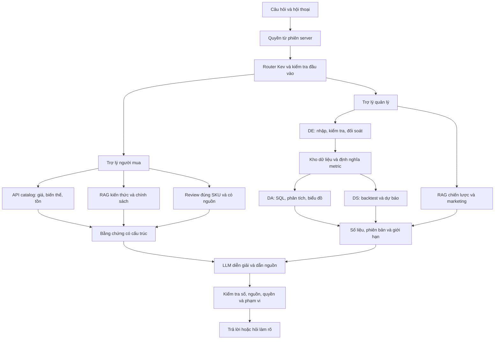

# Hai trợ lý có công cụ: người mua và bộ phận dữ liệu

Ngày 23/10/2026. Yêu cầu mới mở rộng khỏi giai đoạn RAG thuần. Tài liệu này mô tả kiến trúc và thứ tự triển khai. Prototype công cụ đã chạy được; agent hoàn chỉnh và huấn luyện model chưa được thực hiện.

## 1. Hiện trạng đã xác minh

- Engine đã có công cụ sản phẩm và tài chính, nhưng chế độ `basic_rag` bỏ qua graph công cụ. Chỉ đổi prompt sẽ không cung cấp các khả năng mới.
- Backend `store_state.json` có 67 sản phẩm và 35 đơn. Bản `ai_products_export.json` cũ chỉ có 37 sản phẩm. Scenario SQL có 67 SKU và 1.427 đơn trong 12 tháng, từ 10/2025 đến 9/2026.
- Cả 67 ID sản phẩm backend khớp SKU scenario. Tuy nhiên, không được ghép 35 đơn backend vào 1.427 đơn scenario rồi coi đó là cùng một nguồn đầy đủ.
- Giá, tồn và giao dịch trong bộ thử là mô phỏng. Thông số import/backend chưa được xác minh toàn bộ từ hãng cho đúng SKU.
- Backend có API sản phẩm và review. Frontend hiển thị chi tiết bằng modal, chưa có permalink sản phẩm riêng được nối. Không tự chế đường dẫn rồi khẳng định nó hoạt động.
- Bốn review hiện tại có dữ liệu khởi tạo/mẫu và thiếu provenance hoặc cờ xác nhận mua hàng. Chưa thể dùng chúng để kết luận lỗi thực tế của sản phẩm.
- Worker embedding cổng 8011 đang có blocker khởi động đã thông báo. Không thử lại hay vượt lệnh bị chặn. Các công cụ dữ liệu độc lập vẫn kiểm thử offline được.

## 2. Luồng tổng thể

LLM lập kế hoạch và diễn giải. SQL/Python tính toán; thư viện thống kê dự báo; backend kiểm tra quyền. Mỗi kết quả có định nghĩa metric, đơn vị, kỳ, nguồn, độ phủ và revision. LLM không được thay số trong kết quả tính toán để làm lời giải thích có vẻ hợp lý hơn.

## 3. Trợ lý người mua

### Tìm và so sánh

Câu “cho 5 laptop dưới 20 triệu” phải thành yêu cầu công cụ với ngân sách nhỏ hơn 20 triệu, loại sản phẩm, số lượng và nhu cầu. Lọc bằng giá và tồn của chính biến thể đang chọn. Trả tối đa 5 ID sản phẩm khác nhau; nếu chỉ có 3 thì nói có 3, không bịa thêm.

Mỗi kết quả có product ID, variant ID, tên, giá, thời điểm dữ liệu và link đã cấu hình. Dữ liệu snapshot/demo phải ghi nhãn. Khi nối production, dùng API cập nhật và quy tắc TTL thay vì lấy giá từ đoạn RAG cũ.

So sánh phải xác định đúng hai model/SKU/biến thể. Bảng thông số và chênh lệch lấy từ công cụ. Không suy hiệu năng từ tên CPU/GPU, cũng không đổi Wh thành số giờ pin. Dữ liệu benchmark phải có điều kiện thử; thiếu thì nói thiếu.

### Hai bên bảo vệ sản phẩm và bước phản biện

Có thể dùng ba vai: bên A, bên B và người đánh giá trung lập. Chúng cùng đọc một bảng fact đã khóa; mỗi nhận định phải chỉ ra bằng chứng. Hai vai chạy cùng model không phải hai nguồn độc lập và không tự tạo ra sự khách quan.

Phần khách quan gồm thông số và benchmark đủ điều kiện. Phần chủ quan gồm trọng số do người mua chọn, sở thích thiết kế và trải nghiệm review. Đổi trọng số có thể đổi kết luận. Không dùng lợi nhuận bí mật của shop rồi trình bày thành tư vấn khách quan.

Trước mắt, một LLM chạy các lượt có cấu trúc là đủ để thử thiết kế. Chưa cần chạy đồng thời nhiều model hoặc dựng một cuộc tranh luận dài cho mọi câu đơn giản.

### Review và lỗi sản phẩm

Mỗi review cần URL/nguồn, ngày, model và vùng, trạng thái xác nhận mua hàng nếu có, cùng nhãn dữ liệu thật/mẫu. Lọc trùng và spam có căn cứ, ẩn thông tin cá nhân, giữ cả nhận xét trái chiều. Nội dung comment là dữ liệu, không phải lệnh điều khiển agent.

Tóm tắt theo pin, nhiệt, quạt, màn hình, bàn phím và dịch vụ. Cho biết số review hỗ trợ mỗi nhận xét. Tỷ lệ phàn nàn trong một mẫu không phải tỷ lệ hỏng của mọi máy. Thông báo lỗi/thu hồi chính thức phải tách với trải nghiệm cá nhân.

Ý tưởng thêm: hỏi một câu giúp phân biệt nhu cầu; giải thích vì sao chọn hoặc loại một máy; giữ shortlist và tiêu chí qua hội thoại; cảnh báo thiếu thông số đúng SKU; bàn giao nhân viên kèm tóm tắt khi cần.

## 4. Trợ lý admin: DE, DA và DS

### DE: dữ liệu đáng tin trước khi phân tích

Giữ raw bất biến, hash, nguồn và quyền. Lập data dictionary; xác nhận định dạng ngày, tiền tệ, đơn vị, hoàn tiền, thuế và giá vốn. Mapping SKU/nhà cung cấp/kênh phải rõ ràng.

Chỉ loại trùng khi khóa và nội dung chứng minh đó là bản ghi trùng. ID xung đột phải cách ly để đối soát. Giữ ngày thiếu khác ngày doanh thu bằng 0. Không tự xóa outlier vì doanh thu cao hoặc tự điền tất cả ô thiếu bằng 0.

Dùng các lớp raw → staging → curated. Kho phân tích gồm chiều ngày/sản phẩm/kênh và bảng bán, hoàn, nhập, tồn theo ngày, chi phí. Đối soát tiền, số lượng, FIFO, ngày và SKU trước khi phát hành revision mới.

Chuẩn hóa đơn vị và tên giúp join đúng. Chuẩn hóa feature cho ML chỉ fit trên train và phải lưu transformer. Không ép dữ liệu về gần nhau để làm sai số có vẻ thấp hơn; không dùng thống kê của tương lai để làm sạch train.

### DA: số liệu và báo cáo tái lập được

Tạo thư viện metric có định nghĩa: doanh thu thuần, COGS, lãi gộp, biên gộp, chi phí, lãi hoạt động trước lãi vay/thuế, AOV, tỷ lệ hoàn và ngày hết hàng. Nêu rõ mức SKU/nhóm/kênh/kỳ và giới hạn phân bổ chi phí.

Agent gọi SQL tham số hoặc semantic query đã kiểm tra. Không cho model chạy SQL/Python tùy ý trên máy chủ. Biểu đồ có đơn vị, nguồn, kỳ và data revision, kèm bảng để kiểm lại. Excel/Power BI có thể là đầu vào hoặc đầu ra; quy mô thử hiện tại chưa cần Spark/Airflow.

### DS: chọn mô hình theo bài toán

Trước hết xác định target, horizon, thời điểm quyết định và chi phí dự báo sai. Số bán quan sát khác nhu cầu thực khi hết hàng. Giá, khuyến mãi và biến ngoài chỉ được dùng nếu đã biết ở thời điểm dự báo.

Một năm tổng hợp theo tháng chỉ có 12 điểm. Dữ liệu 365 ngày × 67 SKU không thành từng ấy quan sát độc lập. Nhiều SKU bán thưa cần mô hình phù hợp hoặc gộp nhóm; một chu kỳ năm chưa chứng minh học được mùa vụ năm tốt.

Ladder đề xuất:

1. Naïve và seasonal naïve làm đối chứng.
2. ETS/ARIMA; Croston/TSB nếu nhu cầu gián đoạn.
3. Gradient boosting với lag, rolling, lịch, giá và khuyến mãi biết trước.
4. NHITS, DeepAR hoặc TFT khi dữ liệu và backtest cho thấy cần thiết.

Không mặc định LSTM. Forecast model không thay LLM; LLM không thay forecast model. Các thư viện StatsForecast/MLForecast/NeuralForecast là ứng viên, chưa được cài hay train trong lượt này.

Đánh giá theo rolling origin và thời gian, không random split chuỗi. So MAE/WAPE/MASE, bias và độ phủ khoảng dự báo; quy định cách xử lý chuỗi toàn 0. Đo thêm chi phí thiếu hàng/tồn dư bằng giả định minh bạch. Không chọn model chỉ vì train loss nhỏ.

LLM nhận KPI, forecast, cảnh báo chất lượng và tài liệu chiến lược để trình bày: điều đã quan sát, bằng chứng, giả thuyết chưa xác minh, phương án và điều kiện. Doanh thu tăng cùng chiến dịch không chứng minh chiến dịch là nguyên nhân. Đề xuất nhập hàng cần lead time, MOQ, tiền mặt và chính sách; không tự đặt nhập hay đổi giá.

## 5. Kev, LLM và RAG/HyDE

Kev phù hợp quyết định intent, công cụ, độ phức tạp, thiếu đối tượng/kỳ hoặc cần chuyển cấp. Nó không phải model viết báo cáo dài hay máy tính KPI. Hiệu chuẩn trên tập tiếng Việt của shop; ngưỡng xác suất cũ không phải tỷ lệ chính xác được bảo đảm. Quyền vẫn do server quyết định.

Giữ Qwen3 4B đang chạy làm baseline tích hợp tool. Máy đã ghi nhận RTX2060 6GB VRAM và 8GB RAM; không tự tải model lớn rồi hứa chạy nhanh. Ứng viên khi có hạ tầng phù hợp: Qwen3-8B; Qwen3.5-9B sau khi giải quyết runtime compatibility. Chưa có benchmark shop để gọi model nào tốt nhất.

Huấn luyện Kev bằng câu hỏi routing có nhãn đã kiểm, gồm có dấu/không dấu, lỗi nhẹ và hội thoại. Tách theo nhóm để paraphrase không rò sang test. Đo confusion matrix, F1, calibration, coverage và error cost. Không nhồi giá/doanh thu biến động vào trọng số. Chỉ train sau khi có bộ nhãn và kế hoạch kiểm định.

RAG dùng cho công nghệ, chính sách và chiến lược. SQL/forecast tool xử lý số liệu. HyDE chỉ là nhánh phụ cho truy xuất kiến thức tự nhiên, giữ query gốc và bộ lọc. Không dùng tài liệu giả để xác nhận SKU, giá, tồn hay metric; không lưu nó làm kiến thức. Phải đo ablation, recall, độ đúng và độ trễ.

## 6. Skill phải có công cụ thực thi

Mỗi skill cần input schema, role, nguồn được phép, tool allowlist, dependency/version, output schema, provenance và ca kiểm thử. Ưu tiên: tìm catalog, so sánh, tóm tắt review, profile bảng, kiểm schema, đối soát bán hàng, tính metric, vẽ biểu đồ, backtest và giải thích insight.

Một thư mục prompt không tự tạo ra năng lực DE/DA/DS. Excel import còn phải xây: xem trước sheet và mapping ngày/số/đơn vị, báo lỗi và quarantine, đối soát rồi mới phát hành curated revision. Dataset ngoài shop chỉ phục vụ nghiên cứu/thử pipeline, không ghép thành doanh thu shop. Lưu giấy phép và provenance.

## 7. Prototype đã làm

- `shopbot/agent_tools.py`: public projection bỏ trường giá vốn/private; tìm theo giá của biến thể còn hàng, trả 5 product ID khác nhau; so 13 trường gồm giá biến thể và delta Python. Nhiều biến thể thì yêu cầu chọn ID chính xác, không tự chọn winner.
- Dispatcher có `catalog.search`, `catalog.compare`, `admin.finance`, `admin.finance_chart`. Chặn khách gọi tài chính và chặn arg SQL/code/path/role. Caller còn phải nối principal role từ phiên xác thực thật.
- Snapshot mới đủ 67 sản phẩm trong `data/agent_platform_20261023/catalog_v1`, không sửa bản export 37 sản phẩm cũ. Nhãn mô phỏng, hash và thời gian chụp rõ ràng.
- Smoke test tìm được 17 laptop dưới 20 triệu có biến thể còn hàng, lấy đúng 5; so hai máy; tạo báo cáo SQL và biểu đồ Q3/2026. Kết quả ở `reports/agent_platform_20261023/SMOKE.json`.
- Product page URL để null vì chưa có permalink được nối. `api_path` là route API hiện có, không giả làm trang mua hàng.
- 11 test mới và toàn bộ 204 test đã qua, 53,84 giây. Đây là kiểm tra công cụ và hồi quy code, chưa phải đánh giá agent hội thoại.

Chưa nối công cụ vào Engine/chat/backend auth; chưa thu review thật, nhập Excel, train forecast/Kev, triển khai tranh luận sản phẩm, chạy HyDE ablation hay nâng model. Không đổi model/config, bank/gold và kết quả lịch sử. Không clone thêm repo hoặc tải data chưa cần.

## 8. Thứ tự tiếp tục

Cập nhật triển khai sau admin r4: đã nối hội thoại buyer và admin SQL/biểu đồ trong Engine ở chế độ opt-in agent_tools; xem CURRENT.md và `AI/evaluation/agent_admin_20261023_r4/REPORT.md`. Các mô tả “chưa nối Engine” ở phần prototype ban đầu bên trên là trạng thái lịch sử, không phải trạng thái mới nhất. Mặc định app, frontend và backend auth vẫn chưa thay; DE/DS/Kev training/HyDE chưa triển khai. Development60/60 và248test không thay kiểm định độc lập hay nghiệm thu production.

Cập nhật DE tiếp theo: đã có audit chỉ đọc và raw capture/staging theo hash/revision tại `AI/data/de_pipeline/retail_sim_v1/revision_20261023_1607`; xem CURRENT.md và `AI/evaluation/de_snapshot_20261023_r1/REPORT.md`. DE mới hoàn thành phần lưu/kiểm tra nguồn; chưa mapping Excel, đối soát tồn/FIFO đầy đủ hoặc phát hành curated. Không đổi nguồn bot hay cấu hình mặc định.

Cập nhật24/10: đã bổ sung đối soát chứng từ nhận/bán/hoàn, FIFO và snapshot tồn trên raw đã chụp;58check và284test qua, báo cáo `AI/evaluation/de_reconciliation_20261024_r2/REPORT.md`. Chưa xác nhận mọi nghiệp vụ/chính sách/tiền tệ và chưa phát hành curated; trạng thái chi tiết mới nhất nằm ở CURRENT.md, các đoạn prototype trước đó là lịch sử.

1. Nối catalog tool với nguồn backend/API được cấu hình và phiên xác thực; kiểm giá/tồn theo biến thể, TTL và độ cũ dữ liệu.
2. Structured tool routing và hội thoại: tìm máy, so sánh, hỏi lại, giữ ngữ cảnh và dẫn nguồn. Tạo evaluation mới cho agent; không dùng điểm RAG 479 cũ để nghiệm thu khả năng tool.
3. Pipeline nhập/kiểm tra/đối soát, semantic metrics và DA báo cáo/biểu đồ. Làm phần độc lập offline trong khi embedding chưa sẵn sàng.
4. Baseline DS và backtest; chỉ thêm Deep Learning khi có bằng chứng tốt hơn.
5. Review corpus có nguồn; so sánh theo vai và trọng số nhu cầu, kiểm cả phản biện và nhận định nguyên nhân.
6. Train/hiệu chuẩn Kev và thử HyDE có đối chứng khi các điều kiện đã đủ.

Chưa sửa frontend trong giai đoạn này. Khi đấu nối giao diện, cần permalink thật; không tự chế link. Write actions kinh doanh cần quy trình duyệt riêng, trước mắt mọi tool chỉ đọc.

## Nguồn

- Kev: https://github.com/jaredpalmer/kev — decision API, fine-tuning và calibration; không dùng điểm repo làm độ đúng tiếng Việt của shop.
- HyDE: https://aclanthology.org/2023.acl-long.99/ .
- Forecasting: https://otexts.com/fpp3/toolbox.html ; time split: https://scikit-learn.org/stable/modules/cross_validation.html#time-series-split .
- Thư viện ứng viên: https://nixtlaverse.nixtla.io/statsforecast ; https://nixtlaverse.nixtla.io/neuralforecast/docs/capabilities/overview.html .
- Model cards, chưa benchmark trên shop: https://huggingface.co/Qwen/Qwen3-8B ; https://huggingface.co/Qwen/Qwen3.5-9B .
- Đã đối chiếu tài liệu local: `documnets/ke-hoach-ba-chatbot-shop-dien-tu.md`, `D:/Chatbot/Ai-agent-book/book-vi/chapter4.vi.md` và `chapter5.vi.md` về công cụ, quyền và luồng agent.
