<!-- trang-bia -->
TRƯỜNG: [Tên trường]
KHOA: [Tên khoa]

BÁO CÁO MÔN HỌC
KHO DỮ LIỆU VÀ KHAI PHÁ DỮ LIỆU

ĐỀ TÀI:
XÂY DỰNG CHATBOT TƯ VẤN BÁN HÀNG TECHSTORE
ỨNG DỤNG TRUY XUẤT THÔNG TIN LAI
VÀ PHÂN LỚP Ý ĐỊNH

Giảng viên hướng dẫn: [Họ tên giảng viên]
Sinh viên thực hiện: [Họ tên, mã sinh viên]
Lớp: [Tên lớp]

Năm 2026
<!-- het-trang-bia -->

# MỤC LỤC

<!-- muc-luc -->
- Danh mục từ viết tắt và thuật ngữ
- Lời mở đầu
- Chương 1. Tổng quan về kho dữ liệu và phương pháp khai phá dữ liệu
- Chương 2. Các phương pháp khai phá dữ liệu cùng nhánh với đề tài
- Chương 3. Ứng dụng vào chatbot TechStore
- Kết luận
- Tài liệu tham khảo
- Phụ lục
<!-- het-muc-luc -->

# DANH MỤC TỪ VIẾT TẮT VÀ THUẬT NGỮ

Bảng dưới đây giải thích các từ chuyên môn dùng trong báo cáo. Khi một từ xuất hiện lần đầu trong bài, báo cáo cũng giải thích ngắn ngay tại chỗ.

*Bảng 0.1. Từ viết tắt và thuật ngữ*

| Thuật ngữ | Viết đầy đủ | Giải thích dễ hiểu |
|---|---|---|
| CSDL | Cơ sở dữ liệu | Nơi lưu dữ liệu có cấu trúc, ví dụ các bảng đơn hàng, khách hàng. |
| OLTP | Online Transaction Processing | Hệ thống ghi giao dịch hằng ngày: tạo đơn, trừ kho, thanh toán. Ưu tiên ghi nhanh, đúng. |
| OLAP | Online Analytical Processing | Hệ thống phân tích: cộng dồn, so sánh, cắt lát dữ liệu lớn để ra báo cáo. Ưu tiên đọc nhanh. |
| DW | Data Warehouse (kho dữ liệu) | Nơi gom dữ liệu từ nhiều nguồn, làm sạch, giữ lịch sử, dùng để phân tích. |
| Data mart | Kho dữ liệu chủ đề | Một phần nhỏ của kho, phục vụ một phòng ban (bán hàng, kho, tài chính). |
| ETL | Extract – Transform – Load | Ba bước đưa dữ liệu vào kho: lấy ra, biến đổi cho sạch và thống nhất, nạp vào. |
| Fact table | Bảng sự kiện | Bảng ghi các con số đo được của nghiệp vụ, ví dụ số lượng bán, doanh thu. |
| Dimension table | Bảng chiều | Bảng mô tả ngữ cảnh của con số: ngày nào, sản phẩm gì, khách nào. |
| Grain | Độ mịn | Một dòng trong bảng sự kiện biểu diễn điều gì, ví dụ "một dòng = một sản phẩm trong một đơn". |
| KDD | Knowledge Discovery in Databases | Toàn bộ quá trình đi từ dữ liệu thô đến tri thức dùng được. Khai phá dữ liệu là một bước trong đó. |
| CRISP-DM | Cross-Industry Standard Process for Data Mining | Quy trình chuẩn 6 giai đoạn để làm một dự án khai phá dữ liệu. |
| Khai phá văn bản | Text mining | Khai phá dữ liệu trên văn bản tự nhiên (câu hỏi, bài viết). |
| Truy xuất thông tin | Information Retrieval (IR) | Bài toán tìm ra tài liệu liên quan nhất với một câu hỏi, giống máy tìm kiếm. |
| Token | Đơn vị từ | Mảnh nhỏ nhất máy xử lý: một từ, một âm tiết hoặc một mảnh từ. |
| TF-IDF | Term Frequency – Inverse Document Frequency | Cách cho điểm một từ: xuất hiện nhiều trong tài liệu này nhưng hiếm ở tài liệu khác thì điểm cao. |
| BM25 | Best Matching 25 | Công thức chấm điểm tài liệu theo từ khóa, cải tiến từ TF-IDF, dùng trong nhiều máy tìm kiếm. |
| Embedding | Vector nhúng | Dãy số (ví dụ 768 số) biểu diễn nghĩa của một câu. Hai câu cùng nghĩa có vector gần nhau. |
| Cosine | Độ tương tự cosine | Đo góc giữa hai vector. Góc càng nhỏ thì hai câu càng giống nghĩa. Giá trị từ −1 đến 1. |
| RRF | Reciprocal Rank Fusion | Cách trộn nhiều bảng xếp hạng thành một, chỉ dựa trên thứ hạng. |
| RAG | Retrieval-Augmented Generation | Mô hình ngôn ngữ trả lời dựa trên tài liệu tìm được, thay vì trả lời theo trí nhớ. |
| LLM | Large Language Model | Mô hình ngôn ngữ lớn, ví dụ Qwen, GPT. Đọc và sinh văn bản. |
| Fine-tune | Tinh chỉnh | Huấn luyện thêm một mô hình có sẵn trên dữ liệu riêng để nó làm tốt một việc cụ thể. |
| LoRA | Low-Rank Adaptation | Cách tinh chỉnh tiết kiệm: giữ nguyên mô hình gốc, chỉ học thêm hai ma trận nhỏ. |
| Router | Bộ định tuyến | Phần của chatbot quyết định câu hỏi đi đường nào: trả lời, hỏi lại, từ chối… |
| Intent | Ý định | Mục đích của câu hỏi, ví dụ "hỏi bảo hành", "muốn đặt hàng". |
| kNN | k-Nearest Neighbors | Thuật toán phân lớp: xem k điểm gần nhất thuộc nhãn nào nhiều nhất. |
| SVM | Support Vector Machine | Thuật toán phân lớp: tìm đường ranh giới cách xa hai nhóm nhất. |
| Precision | Độ chính xác | Trong các kết quả máy trả về, bao nhiêu phần đúng. |
| Recall | Độ phủ | Trong các kết quả đúng có thật, máy tìm được bao nhiêu phần. |
| F1 | F1-score | Trung bình điều hòa của precision và recall, một con số tóm tắt cả hai. |
| MRR | Mean Reciprocal Rank | Trung bình của 1/hạng của kết quả đúng đầu tiên. Kết quả đúng càng lên đầu thì càng cao. |
| Train / dev / test | Tập huấn luyện / kiểm định / kiểm tra | Ba phần dữ liệu tách riêng: để học, để chỉnh, để chấm điểm cuối. |
| Rò rỉ dữ liệu | Data leakage | Lỗi để dữ liệu dùng chấm điểm lọt vào lúc học, làm điểm cao giả. |
| SQL | Structured Query Language | Ngôn ngữ truy vấn cơ sở dữ liệu quan hệ. |
| API | Application Programming Interface | Cổng để chương trình này gọi chương trình khác, ví dụ web gọi dịch vụ AI. |
| GPU | Graphics Processing Unit | Card đồ họa, tính song song nhanh, dùng để chạy và huấn luyện mô hình. |
| GGUF | — | Định dạng file nén model để chạy bằng Ollama hoặc llama.cpp. |
| Ollama | — | Phần mềm chạy mô hình ngôn ngữ trên máy riêng. |
| FIFO | First In, First Out | Cách tính giá vốn: hàng nhập trước thì xuất trước. |

# LỜI MỞ ĐẦU

## Lý do chọn đề tài

Cửa hàng bán máy tính và linh kiện nhận rất nhiều câu hỏi lặp lại: máy này RAM bao nhiêu, bảo hành mấy tháng, trả góp thế nào, tầm 20 triệu nên mua máy nào. Người quản lý cửa hàng cũng thường hỏi các câu về số liệu: doanh thu tháng này, lãi gộp quý trước, mặt hàng nào bán chạy. Trả lời tay mất thời gian, còn trả lời sai thì mất khách hoặc ra quyết định sai.

Chatbot dùng mô hình ngôn ngữ lớn (LLM) trả lời rất trôi chảy, nhưng có một nhược điểm lớn: **nó có thể "bịa"**. Nghĩa là nó nói ra một con số hoặc một chính sách nghe rất hợp lý nhưng không có trong dữ liệu của cửa hàng. Với một cửa hàng thật, một câu bịa về giá hoặc bảo hành gây hại nhiều hơn một câu "tôi chưa có thông tin".

Vì vậy đề tài chọn hướng **lấy dữ liệu làm gốc**: mọi câu trả lời phải dựa trên tài liệu hoặc bảng số liệu của cửa hàng, có ghi nguồn. Đây đúng là chỗ môn Kho dữ liệu và Khai phá dữ liệu đi vào: phải tổ chức dữ liệu cho tốt (kho dữ liệu), rồi dùng thuật toán khai phá văn bản để tìm đúng đoạn dữ liệu cho từng câu hỏi (truy xuất thông tin) và hiểu câu hỏi muốn gì (phân lớp ý định).

## Mục tiêu

1. Trình bày tổng quan về kho dữ liệu và khai phá dữ liệu: khái niệm, phân loại, các bước, lĩnh vực ứng dụng và hướng nghiên cứu.
2. Trình bày chi tiết các thuật toán cùng nhánh với thuật toán dùng trong đề tài: biểu diễn văn bản, đo độ tương tự, xếp hạng tài liệu (TF-IDF, BM25, vector nhúng, RRF) và phân lớp (kNN, Naive Bayes, SVM, cây quyết định, mô hình ngôn ngữ tinh chỉnh bằng LoRA).
3. Áp dụng vào chatbot TechStore: tổ chức dữ liệu cửa hàng thành một kho dữ liệu nhỏ, xây dựng luồng hỏi đáp có dẫn nguồn, đo chất lượng bằng các bộ câu hỏi tách riêng.

## Phạm vi

- Dữ liệu: 67 sản phẩm (48 linh kiện, 19 laptop) lấy thông số từ bộ dữ liệu công khai; dữ liệu bán hàng một năm (10/2025 – 9/2026) là **dữ liệu mô phỏng**, không phải số của cửa hàng thật. Nguồn ghi đầy đủ ở mục 3.2 và Phụ lục A.
- Ngôn ngữ: tiếng Việt.
- Người dùng: khách mua (hỏi sản phẩm, chính sách) và quản trị viên (hỏi số liệu kinh doanh).
- Không làm: thanh toán, đặt hàng thật qua chat, giá và tồn kho theo thời gian thực.

## Phương pháp thực hiện

- Nghiên cứu tài liệu: sách giáo trình, bài báo gốc của từng thuật toán, tài liệu kỹ thuật (danh sách ở phần Tài liệu tham khảo).
- Thực nghiệm: cài đặt bằng Python, huấn luyện trên GPU miễn phí của Kaggle, đo bằng hơn 1.500 câu hỏi chia thành nhiều bộ, mỗi bản chạy hai lần để loại bỏ dao động ngẫu nhiên.

## Bố cục báo cáo

- **Chương 1** trình bày tổng quan về kho dữ liệu và khai phá dữ liệu.
- **Chương 2** đi sâu vào các thuật toán của nhánh khai phá văn bản, truy xuất thông tin và phân lớp, có ví dụ tính tay.
- **Chương 3** mô tả cách áp dụng vào chatbot TechStore: nguồn dữ liệu, kho dữ liệu, kiến trúc, luồng xử lý, huấn luyện và kết quả đo.
- Cuối báo cáo là kết luận, tài liệu tham khảo và phụ lục.

# CHƯƠNG 1. TỔNG QUAN VỀ KHO DỮ LIỆU VÀ PHƯƠNG PHÁP KHAI PHÁ DỮ LIỆU

## 1.1. Dữ liệu, thông tin và tri thức

Ba khái niệm này hay bị dùng lẫn, nhưng chúng là ba mức khác nhau:

- **Dữ liệu (data)** là các con số, ký hiệu thô, chưa có ý nghĩa nếu đứng một mình. Ví dụ: một dòng `2026-03-14, SKU-12, 2, 31.980.000`.
- **Thông tin (information)** là dữ liệu đã được đặt vào ngữ cảnh. Ví dụ: "Ngày 14/3/2026 cửa hàng bán 2 chiếc MSI Modern 15, thu 31.980.000 đồng."
- **Tri thức (knowledge)** là quy luật rút ra từ nhiều thông tin, dùng để ra quyết định. Ví dụ: "Laptop bán chạy nhất vào quý 4 (mùa mua sắm cuối năm), nên nhập thêm hàng từ tháng 9."

Kho dữ liệu lo việc biến **dữ liệu** thành **thông tin** sạch, thống nhất. Khai phá dữ liệu lo việc đi từ **thông tin** đến **tri thức**.

## 1.2. Kho dữ liệu

### 1.2.1. Khái niệm

Định nghĩa được dùng nhiều nhất là của W. H. Inmon, người được gọi là "cha đẻ của kho dữ liệu" [3]:

> **Định nghĩa (Inmon):** Kho dữ liệu là một tập dữ liệu **hướng chủ đề, tích hợp, gắn với thời gian và không thay đổi**, dùng để hỗ trợ quá trình ra quyết định của nhà quản lý.

Bốn đặc điểm trong định nghĩa được hiểu như sau:

1. **Hướng chủ đề (subject-oriented):** dữ liệu được sắp theo chủ đề kinh doanh (bán hàng, khách hàng, tồn kho), không sắp theo từng phần mềm. Phần mềm bán hàng, phần mềm kho, file Excel kế toán có thể khác nhau, nhưng trong kho dữ liệu chúng gom về chung một chủ đề "bán hàng".
2. **Tích hợp (integrated):** dữ liệu từ nhiều nguồn được thống nhất về cách ghi. Ví dụ nguồn A ghi giới tính là "Nam/Nữ", nguồn B ghi "M/F", nguồn C ghi "1/0"; vào kho thì phải về một kiểu. Đơn vị tiền, định dạng ngày, mã sản phẩm cũng phải thống nhất.
3. **Gắn với thời gian (time-variant):** mỗi dòng dữ liệu đều có mốc thời gian, và kho giữ lịch sử nhiều năm. CSDL giao dịch thường chỉ giữ trạng thái hiện tại (tồn kho hôm nay), còn kho giữ cả tồn kho của từng ngày trong quá khứ.
4. **Không thay đổi (non-volatile):** dữ liệu vào kho rồi thì chỉ đọc và thêm mới, không sửa hay xóa từng dòng như CSDL giao dịch. Nhờ vậy báo cáo chạy hôm nay và chạy lại sau một tháng cho cùng kết quả.

Ralph Kimball đưa ra một cách nhìn thực tế hơn: kho dữ liệu là **"bản sao dữ liệu giao dịch được tổ chức riêng để truy vấn và phân tích"** [4]. Hai định nghĩa không mâu thuẫn mà nhấn mạnh hai mặt khác nhau: Inmon nhấn mạnh tính chất của dữ liệu, Kimball nhấn mạnh cách dùng.

### 1.2.2. Vì sao cần kho dữ liệu: OLTP và OLAP

Cửa hàng đã có CSDL bán hàng, vậy tại sao không phân tích thẳng trên đó? Vì hai loại công việc này có yêu cầu ngược nhau.

*Bảng 1.1. So sánh hệ thống giao dịch (OLTP) và hệ thống phân tích (OLAP)*

| Tiêu chí | OLTP (CSDL giao dịch) | OLAP (kho dữ liệu) |
|---|---|---|
| Mục đích | Ghi nhận nghiệp vụ hằng ngày | Phân tích, báo cáo, ra quyết định |
| Người dùng | Nhân viên bán hàng, thu ngân | Quản lý, nhà phân tích |
| Thao tác chính | Thêm, sửa, xóa từng dòng | Đọc, cộng dồn hàng triệu dòng |
| Dữ liệu | Hiện tại, chi tiết | Lịch sử nhiều năm, đã tổng hợp |
| Thiết kế bảng | Chuẩn hóa cao (3NF) để tránh trùng | Phi chuẩn hóa (lược đồ hình sao) để đọc nhanh |
| Câu truy vấn | Ngắn, biết trước ("đơn số 123") | Phức tạp, thay đổi ("doanh thu laptop theo quý, theo kênh") |
| Ưu tiên | Ghi nhanh, không mất giao dịch | Đọc nhanh, số liệu nhất quán |

Nếu chạy một câu phân tích nặng ngay trên CSDL giao dịch, câu đó có thể khóa bảng và làm chậm việc bán hàng. Ngoài ra dữ liệu giao dịch thường nằm rải rác ở nhiều hệ thống khác nhau, không cái nào có đủ bức tranh. Kho dữ liệu giải quyết cả hai: tách việc phân tích ra chỗ riêng, và gom mọi nguồn về một chỗ.

### 1.2.3. Kiến trúc kho dữ liệu


Một kho dữ liệu điển hình có các tầng sau (Hình 1.1):

1. **Tầng nguồn:** CSDL bán hàng, file Excel/CSV, dữ liệu từ web hoặc API của đối tác, nhật ký (log) truy cập website.
2. **Tầng ETL** (trích xuất – biến đổi – nạp):
   - *Trích xuất (Extract):* lấy dữ liệu ra khỏi nguồn, thường theo lịch (mỗi đêm, mỗi giờ). Có thể lấy toàn bộ hoặc chỉ phần thay đổi kể từ lần trước.
   - *Biến đổi (Transform):* làm sạch (bỏ trùng, sửa lỗi), thống nhất mã và đơn vị, tính các cột mới (doanh thu = số lượng × đơn giá − giảm giá), nối dữ liệu từ nhiều nguồn.
   - *Nạp (Load):* ghi vào kho. Nạp lần đầu là nạp toàn bộ, các lần sau thường chỉ nạp thêm phần mới.
3. **Vùng tạm (staging area):** nơi để dữ liệu thô vừa lấy về trước khi biến đổi. Có vùng tạm thì khi biến đổi lỗi, ta chạy lại từ đây mà không phải lấy lại từ nguồn.
4. **Kho dữ liệu trung tâm:** dữ liệu đã sạch, tích hợp, có lịch sử.
5. **Data mart:** các kho nhỏ theo phòng ban (bán hàng, kho, tài chính), tách ra từ kho trung tâm cho gọn và nhanh.
6. **Tầng khai thác:** báo cáo, công cụ BI (Business Intelligence), phân tích OLAP, khai phá dữ liệu, và ngày nay cả chatbot hỏi đáp.
7. **Siêu dữ liệu (metadata):** "dữ liệu về dữ liệu", ghi bảng nào lấy từ nguồn nào, cập nhật lúc nào, cột nào nghĩa là gì. Thiếu siêu dữ liệu thì người dùng không biết tin số liệu đến đâu.

> **Điểm kỹ thuật – ETL hay ELT:** với kho dữ liệu trên cloud hiện nay, nhiều nơi làm theo thứ tự **ELT**: nạp dữ liệu thô vào kho trước, rồi biến đổi ngay trong kho bằng SQL, vì kho cloud tính rất mạnh. ETL truyền thống biến đổi trước khi nạp, phù hợp khi kho có tài nguyên hạn chế hoặc dữ liệu thô không được phép lưu.

### 1.2.4. Mô hình dữ liệu nhiều chiều

Kho dữ liệu thường không thiết kế theo kiểu chuẩn hóa như CSDL giao dịch, mà theo **mô hình nhiều chiều (dimensional model)**. Mô hình này có hai loại bảng:

- **Bảng sự kiện (fact table):** mỗi dòng là một sự kiện nghiệp vụ đo được, chứa các **độ đo (measure)** là con số: số lượng, doanh thu, giá vốn. Bảng này rất dài (hàng triệu dòng) nhưng hẹp (ít cột).
- **Bảng chiều (dimension table):** mô tả ngữ cảnh: thời gian, sản phẩm, khách hàng, cửa hàng. Bảng này ngắn nhưng rộng (nhiều cột mô tả).

Trước khi thiết kế phải chốt **độ mịn (grain)**: một dòng trong bảng sự kiện là gì. Ví dụ "một dòng = một sản phẩm trong một đơn hàng". Chọn độ mịn quá thô (một dòng = tổng một ngày) thì không trả lời được câu hỏi chi tiết; chọn quá mịn thì bảng phình to.

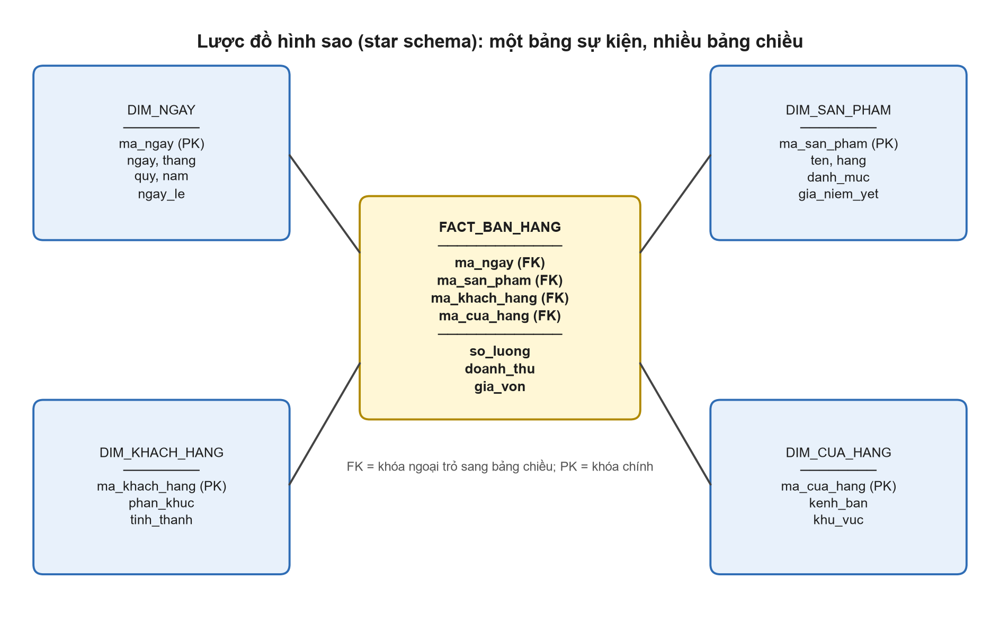

Có ba kiểu lược đồ:

1. **Lược đồ hình sao (star schema):** một bảng sự kiện ở giữa, các bảng chiều xung quanh nối trực tiếp vào (Hình 1.2). Đơn giản, truy vấn ít phép nối, nên được dùng nhiều nhất.
2. **Lược đồ bông tuyết (snowflake schema):** bảng chiều được tách nhỏ thêm. Ví dụ bảng sản phẩm tách thành sản phẩm → danh mục → ngành hàng. Tiết kiệm chỗ, nhưng truy vấn phải nối nhiều bảng hơn.
3. **Lược đồ chòm sao (galaxy / fact constellation):** nhiều bảng sự kiện dùng chung bảng chiều. Ví dụ bảng "bán hàng" và bảng "tồn kho" cùng dùng chiều thời gian và chiều sản phẩm. Kho dữ liệu của đề tài (mục 3.3) thuộc kiểu này.

> **Điểm kỹ thuật – chiều thay đổi chậm (SCD):** thuộc tính của chiều có thể đổi theo thời gian, ví dụ khách chuyển từ phân khúc "mua một lần" sang "thân thiết". Có ba cách xử lý chính: **SCD loại 1** ghi đè (mất lịch sử), **SCD loại 2** thêm dòng mới kèm ngày hiệu lực (giữ lịch sử đầy đủ), **SCD loại 3** thêm cột "giá trị cũ" (giữ được một bước lịch sử).

### 1.2.5. Các thao tác OLAP

Dữ liệu nhiều chiều thường được hình dung như một **khối lập phương dữ liệu (data cube)**: mỗi cạnh là một chiều (thời gian, sản phẩm, kênh bán), mỗi ô chứa độ đo (doanh thu). Các thao tác OLAP là các cách "xoay, cắt, gộp" khối này.

*Bảng 1.2. Các thao tác OLAP, ví dụ trên dữ liệu cửa hàng của đề tài*

| Thao tác | Ý nghĩa | Ví dụ với dữ liệu đề tài |
|---|---|---|
| Roll-up (cuộn lên) | Gộp lên mức cao hơn của một chiều | Từ doanh thu laptop theo quý lên doanh thu laptop cả năm: 9.043.111.000 đ |
| Drill-down (khoan xuống) | Đi xuống mức chi tiết hơn | Từ doanh thu quý 4/2025 (3.952.314.000 đ) xuống từng tháng: tháng 10 là 984.310.000 đ, tháng 11 là 1.493.219.000 đ, tháng 12 là 1.474.785.000 đ |
| Slice (cắt lát) | Cố định một chiều ở một giá trị | Chỉ xem kênh "cửa hàng": 768 trên 1.427 đơn |
| Dice (cắt khối) | Lọc nhiều chiều cùng lúc | Laptop, quý 1/2026, kênh website |
| Pivot (xoay) | Đổi hàng thành cột để nhìn khác | Bảng nhóm hàng × quý thành bảng quý × nhóm hàng |

Các số trong Bảng 1.2 lấy từ cơ sở dữ liệu mô phỏng của đề tài (`shop.sqlite`). Phép roll-up được kiểm tra lại: cộng doanh thu bốn quý của laptop, và cộng doanh thu ba tháng của quý 4/2025, đều khớp với view tổng hợp `monthly_pnl`.

### 1.2.6. Hai trường phái xây dựng: Inmon và Kimball

*Bảng 1.3. So sánh cách tiếp cận Inmon và Kimball*

| Tiêu chí | Inmon (từ trên xuống) | Kimball (từ dưới lên) |
|---|---|---|
| Cách làm | Xây kho trung tâm chuẩn hóa trước, rồi tách data mart | Xây từng data mart theo lược đồ hình sao, nối bằng các chiều dùng chung |
| Thời gian ra kết quả đầu tiên | Lâu | Nhanh |
| Tính nhất quán toàn công ty | Cao | Phụ thuộc vào việc giữ chiều dùng chung (conformed dimension) |
| Phù hợp | Tổ chức lớn, nhiều nguồn phức tạp | Doanh nghiệp vừa và nhỏ, cần kết quả sớm |

Hiện nay còn có **hồ dữ liệu (data lake)**: lưu mọi dữ liệu thô (cả văn bản, ảnh, log) với chi phí rẻ, chưa cần thiết kế trước. Kết hợp hồ dữ liệu với khả năng quản lý của kho dữ liệu thì gọi là **lakehouse**. Đề tài dùng cả hai ý: bảng số liệu có cấu trúc nằm trong SQLite (giống kho dữ liệu), còn tài liệu văn bản nằm trong thư mục có file kê khai `manifest.json` (giống hồ dữ liệu có siêu dữ liệu).

### 1.2.7. Phân loại kho dữ liệu

- **Kho dữ liệu doanh nghiệp (Enterprise Data Warehouse – EDW):** kho trung tâm cho toàn công ty.
- **Data mart phụ thuộc:** lấy dữ liệu từ EDW. **Data mart độc lập:** lấy thẳng từ nguồn (nhanh nhưng dễ lệch số giữa các phòng).
- **Kho dữ liệu tác nghiệp (Operational Data Store – ODS):** dữ liệu gần thời gian thực, ít lịch sử, phục vụ báo cáo trong ngày.
- **Kho dữ liệu ảo:** không chép dữ liệu, chỉ tạo lớp truy vấn đứng trên các nguồn.

## 1.3. Khai phá dữ liệu

### 1.3.1. Khái niệm

> **Định nghĩa:** Khai phá dữ liệu (data mining) là quá trình tìm ra các **mẫu (pattern)** có giá trị, mới, có thể hiểu được và có ích trong một lượng dữ liệu lớn [1], [2].

Bốn chữ quan trọng trong định nghĩa:

- **Có giá trị (valid):** mẫu phải đúng với cả dữ liệu mới, không chỉ đúng với dữ liệu đã thấy.
- **Mới (novel):** không phải điều ai cũng biết sẵn. "Khách mua laptop thì mua laptop" không phải phát hiện.
- **Hiểu được (understandable):** người dùng đọc được và giải thích được.
- **Có ích (useful):** dùng được để hành động, ví dụ quyết định nhập hàng, chạy khuyến mãi.

Fayyad và cộng sự (1996) phân biệt rõ: **KDD** (khám phá tri thức trong CSDL) là **toàn bộ quá trình** từ chọn dữ liệu đến diễn giải kết quả; **khai phá dữ liệu** chỉ là **một bước** trong quá trình đó, bước áp dụng thuật toán để tìm mẫu [2]. Trong thực tế hai từ này thường dùng lẫn cho nhau.

Cũng cần phân biệt với những việc **không** phải khai phá dữ liệu:

- Chạy câu SQL "tổng doanh thu tháng 3" là **truy vấn**, không phải khai phá: câu trả lời đã biết cách tính, chỉ cần tính.
- Vẽ biểu đồ doanh thu theo tháng là **thống kê mô tả**.
- Khai phá là khi ta **chưa biết trước** quy luật, ví dụ: "những khách nào sắp bỏ đi", "sản phẩm nào hay được mua cùng nhau", "câu hỏi này thuộc loại nào".

### 1.3.2. Quan hệ với các ngành khác

Khai phá dữ liệu là chỗ giao nhau của nhiều ngành:

- **Thống kê:** cung cấp lý thuyết về mẫu, ước lượng, kiểm định.
- **Học máy (machine learning):** cung cấp thuật toán học từ dữ liệu (cây quyết định, mạng nơ-ron…).
- **Cơ sở dữ liệu:** cung cấp cách lưu và truy vấn dữ liệu lớn hiệu quả, chính là kho dữ liệu.
- **Truy xuất thông tin và xử lý ngôn ngữ tự nhiên:** cung cấp cách làm việc với văn bản. Đây là nhánh đề tài dùng nhiều nhất.
- **Trực quan hóa:** giúp con người nhìn ra và kiểm tra mẫu.

## 1.4. Phân loại khai phá dữ liệu

Có nhiều cách phân loại, tùy nhìn theo mục đích, loại dữ liệu, kỹ thuật hay cách học.

### 1.4.1. Theo mục đích


**Khai phá dự đoán (predictive):** dùng dữ liệu đã có nhãn (đã biết đáp án) để đoán giá trị cho dữ liệu mới.

- **Phân lớp (classification):** đoán nhãn rời rạc. Ví dụ: email là "rác" hay "không rác"; câu hỏi của khách thuộc loại "hỏi sản phẩm", "hỏi chính sách" hay "muốn đặt hàng".
- **Hồi quy (regression):** đoán giá trị liên tục. Ví dụ: giá một chiếc laptop theo cấu hình.
- **Dự báo chuỗi thời gian (forecasting):** đoán giá trị tương lai dựa vào quá khứ. Ví dụ: số máy bán ngày mai.

**Khai phá mô tả (descriptive):** không có nhãn, tìm cấu trúc ẩn trong dữ liệu.

- **Phân cụm (clustering):** gom các đối tượng giống nhau thành nhóm. Ví dụ: chia khách thành nhóm "săn khuyến mãi", "thân thiết", "mua một lần".
- **Luật kết hợp (association rules):** tìm các thứ hay đi cùng nhau. Ví dụ: "mua CPU thì 60% mua thêm mainboard" (thuật toán Apriori [5]).
- **Phát hiện bất thường (anomaly detection):** tìm điểm lạ. Ví dụ: giao dịch gian lận, đơn hoàn trả bất thường.

Nhánh của đề tài là **khai phá văn bản và truy xuất thông tin**, nằm giữa hai nhóm (Hình 1.3): phần **phân lớp ý định** thuộc khai phá dự đoán, còn phần **xếp hạng tài liệu theo độ tương tự** dùng cùng ý tưởng "đo khoảng cách" với phân cụm và thuật toán láng giềng gần.

### 1.4.2. Theo loại dữ liệu

- **Dữ liệu quan hệ và giao dịch:** bảng đơn hàng, giỏ hàng. Dùng cho luật kết hợp, phân lớp khách hàng.
- **Chuỗi thời gian:** doanh thu theo ngày, giá cổ phiếu. Dùng cho dự báo.
- **Văn bản (text mining):** bài viết, câu hỏi, đánh giá sản phẩm. Dùng cho phân loại văn bản, tìm kiếm, tóm tắt.
- **Web mining:** gồm khai phá nội dung trang, cấu trúc liên kết (thuật toán PageRank) và hành vi duyệt web (log).
- **Dữ liệu không gian:** bản đồ, vị trí cửa hàng.
- **Đồ thị và mạng xã hội:** quan hệ giữa người dùng.
- **Đa phương tiện:** ảnh, âm thanh, video.

### 1.4.3. Theo kỹ thuật

- Phương pháp thống kê (hồi quy, Naive Bayes).
- Cây quyết định (ID3, C4.5, CART).
- Phương pháp dựa trên khoảng cách (kNN, k-means).
- Mạng nơ-ron và học sâu (transformer, mô hình ngôn ngữ lớn).
- Phương pháp dựa trên luật (Apriori, luật do chuyên gia viết).
- Phương pháp kết hợp (ensemble: rừng ngẫu nhiên, boosting).

Năm 2006, hội nghị IEEE ICDM bình chọn **10 thuật toán khai phá dữ liệu có ảnh hưởng nhất**: C4.5, k-Means, SVM, Apriori, EM, PageRank, AdaBoost, kNN, Naive Bayes và CART [6]. Chương 2 trình bày những thuật toán trong danh sách này thuộc cùng nhánh với đề tài (kNN, Naive Bayes, SVM, C4.5/CART).

### 1.4.4. Theo cách học

- **Học có giám sát (supervised):** có đáp án mẫu để học. Ví dụ phân lớp, hồi quy.
- **Học không giám sát (unsupervised):** không có đáp án. Ví dụ phân cụm.
- **Học bán giám sát (semi-supervised):** ít dữ liệu có nhãn, nhiều dữ liệu không nhãn.
- **Học tăng cường (reinforcement):** học qua thử – sai và phần thưởng.
- **Học tự giám sát (self-supervised):** tự tạo nhãn từ dữ liệu. Ví dụ che một từ trong câu rồi bắt mô hình đoán lại. Các mô hình ngôn ngữ như BERT, Qwen được huấn luyện ban đầu theo cách này.

## 1.5. Các bước thực hiện khai phá dữ liệu

### 1.5.1. Quy trình KDD

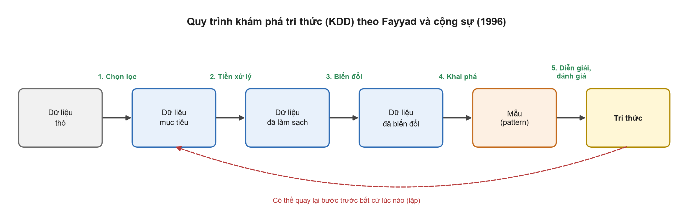

Theo Fayyad và cộng sự [2], quá trình KDD gồm 5 bước chính (Hình 1.4):

1. **Chọn lọc (selection):** xác định bài toán và chọn phần dữ liệu liên quan. Ví dụ muốn dự báo doanh số laptop thì chỉ lấy dữ liệu bán laptop, không cần dữ liệu chuột.
2. **Tiền xử lý (preprocessing):** làm sạch dữ liệu: xử lý giá trị thiếu, bỏ trùng, sửa lỗi nhập. Bước này thường tốn **60–80% thời gian** của cả dự án.
3. **Biến đổi (transformation):** đưa dữ liệu về dạng thuật toán dùng được: chuẩn hóa thang đo, tạo đặc trưng mới, giảm số chiều. Với văn bản, bước này là biến câu chữ thành vector số.
4. **Khai phá (data mining):** chọn và chạy thuật toán: phân lớp, phân cụm, luật kết hợp…
5. **Diễn giải và đánh giá (interpretation/evaluation):** kiểm tra mẫu tìm được có đúng, có ích không, rồi trình bày cho người dùng.

Quá trình này **lặp**: kết quả bước 5 không tốt thì quay lại bước trước, ví dụ chọn thêm dữ liệu hoặc đổi cách biến đổi.

### 1.5.2. Quy trình CRISP-DM


CRISP-DM là quy trình chuẩn dùng trong công nghiệp [7], gồm 6 giai đoạn (Hình 1.5):

*Bảng 1.4. Sáu giai đoạn CRISP-DM và cách đề tài thực hiện*

| Giai đoạn | Việc chính | Trong đề tài |
|---|---|---|
| 1. Hiểu bài toán kinh doanh | Xác định mục tiêu, tiêu chí thành công | Bot trả lời đúng theo dữ liệu cửa hàng, không bịa, có nguồn |
| 2. Hiểu dữ liệu | Thu thập, mô tả, kiểm tra chất lượng | Rà 11 bộ dữ liệu công khai, chọn 2 bộ làm thông số sản phẩm |
| 3. Chuẩn bị dữ liệu | Làm sạch, tích hợp, tạo đặc trưng | Dựng `products.sqlite`, mô phỏng một năm bán hàng, chia đoạn tài liệu |
| 4. Xây dựng mô hình | Chọn thuật toán, huấn luyện | Truy xuất lai TF-IDF + BM25 + vector nhúng; tinh chỉnh Qwen3 4B bằng LoRA |
| 5. Đánh giá | Đo trên dữ liệu chưa thấy, so với mục tiêu | Hơn 1.500 câu hỏi, mỗi bản chạy hai lần, không câu nào được từ đạt thành trượt |
| 6. Triển khai | Đưa vào sử dụng, theo dõi | Dịch vụ FastAPI, web gọi qua `AI_SERVICE_URL` |

Điểm khác của CRISP-DM so với KDD là nó **bắt đầu và kết thúc bằng nghiệp vụ**: giai đoạn đầu là hiểu bài toán kinh doanh, giai đoạn cuối là triển khai vào thực tế, chứ không dừng ở chỗ tìm ra mẫu.

### 1.5.3. Tiền xử lý dữ liệu chi tiết

Dữ liệu thực tế thường "bẩn". Theo Han và cộng sự [1], tiền xử lý gồm bốn việc:

**a) Làm sạch dữ liệu (data cleaning)**

- *Giá trị thiếu:* bỏ dòng, điền bằng trung bình hoặc trung vị, điền bằng giá trị hay gặp nhất, hoặc dùng mô hình để đoán. Với dữ liệu sản phẩm, đề tài **không điền đoán** thông số còn thiếu: thông số nào nguồn không có thì để trống, và bot trả lời "chưa có thông tin", vì đoán sai thông số còn tệ hơn không trả lời.
- *Dữ liệu nhiễu:* giá trị sai lệch, ví dụ giá âm, RAM 1.600 GB. Xử lý bằng chia khoảng (binning), hồi quy, hoặc loại bỏ các điểm vượt ngưỡng.
- *Dữ liệu trùng:* cùng một sản phẩm xuất hiện hai lần với tên hơi khác nhau ("MSI Modern 15" và "MSI Modern15").
- *Dữ liệu mâu thuẫn:* hai nguồn ghi khác nhau. Ví dụ trong đề tài, thông số chuột Logitech G305 ở hai nguồn không khớp nhau; tài liệu ghi rõ cả hai số kèm nguồn thay vì tự chọn một.

**b) Tích hợp dữ liệu (data integration):** gộp nhiều nguồn, xử lý xung đột tên cột, đơn vị (USD và VND), mã sản phẩm.

**c) Thu gọn dữ liệu (data reduction):** giảm số dòng (lấy mẫu), giảm số cột (chọn đặc trưng, PCA), hoặc nén.

**d) Biến đổi dữ liệu (data transformation):**

- *Chuẩn hóa min–max:* đưa về khoảng [0, 1].

```text
x' = (x − min) / (max − min)
Ví dụ: RAM 8, 16, 32 GB  →  0; 0,333; 1
```

- *Chuẩn hóa z-score:* đưa về trung bình 0, độ lệch chuẩn 1.

```text
x' = (x − trung bình) / độ lệch chuẩn
```

- *Rời rạc hóa:* biến số liên tục thành nhóm. Ví dụ giá thành "dưới 15 triệu", "15–25 triệu", "trên 25 triệu".
- *Với văn bản:* chuyển chữ thường, chuẩn hóa dấu, tách từ, biến thành vector (chi tiết ở Chương 2).

### 1.5.4. Đánh giá và chống rò rỉ dữ liệu

Một mô hình chỉ đáng tin khi được chấm trên dữ liệu **nó chưa từng thấy**. Vì vậy dữ liệu được chia làm ba phần:

- **Tập huấn luyện (train):** để mô hình học.
- **Tập kiểm định (validation/dev):** để chọn tham số, so sánh các phiên bản.
- **Tập kiểm tra (test/held-out):** chỉ dùng **một lần** ở cuối để báo cáo kết quả.

> **Điểm kỹ thuật – rò rỉ dữ liệu (data leakage):** nếu câu hỏi trong tập kiểm tra lọt vào lúc huấn luyện, hoặc người làm nhìn tập kiểm tra rồi sửa code cho riêng các câu đó, điểm sẽ cao giả. Đề tài chặn việc này bằng ba cách: (1) loại câu hỏi của mọi bộ đánh giá khỏi dữ liệu huấn luyện, kể cả câu gần giống; (2) phần validation của một số bộ đề chỉ được xem **số đếm** đạt/trượt, không được xem nội dung câu; (3) bộ câu khóa (held-out) chỉ chạy **một lần** khi chốt phiên bản cuối.

## 1.6. Lĩnh vực ứng dụng

*Bảng 1.5. Một số lĩnh vực ứng dụng khai phá dữ liệu*

| Lĩnh vực | Bài toán điển hình | Kỹ thuật hay dùng |
|---|---|---|
| Bán lẻ, thương mại điện tử | Phân tích giỏ hàng, gợi ý sản phẩm, dự báo nhu cầu, phân khúc khách hàng, chatbot tư vấn | Luật kết hợp, lọc cộng tác, phân cụm, dự báo, truy xuất văn bản |
| Tài chính, ngân hàng | Chấm điểm tín dụng, phát hiện gian lận thẻ, chống rửa tiền | Phân lớp, phát hiện bất thường |
| Y tế | Hỗ trợ chẩn đoán, dự đoán tái nhập viện, khai phá hồ sơ bệnh án | Phân lớp, khai phá văn bản |
| Viễn thông | Dự đoán khách rời mạng (churn), tối ưu mạng | Phân lớp, phân cụm |
| Sản xuất | Bảo trì dự đoán, phát hiện lỗi sản phẩm | Chuỗi thời gian, phát hiện bất thường |
| Giáo dục | Dự đoán sinh viên có nguy cơ bỏ học, gợi ý lộ trình | Phân lớp, luật kết hợp |
| Chăm sóc khách hàng | Phân loại yêu cầu, trả lời tự động, phân tích cảm xúc | Phân lớp văn bản, truy xuất thông tin, mô hình ngôn ngữ |
| Khu vực công | Phát hiện gian lận thuế, quy hoạch giao thông | Phát hiện bất thường, dữ liệu không gian |

Lĩnh vực của đề tài là **bán lẻ và chăm sóc khách hàng**. Ở đây khai phá dữ liệu phục vụ hai nhóm người:

- **Khách mua:** cần câu trả lời nhanh, đúng về sản phẩm và chính sách. Đây là bài toán truy xuất thông tin.
- **Người quản lý:** cần số liệu kinh doanh đúng, giải thích được. Đây là bài toán OLAP trên kho dữ liệu, có thêm khả năng hỏi bằng tiếng Việt tự nhiên.

## 1.7. Thách thức và hướng nghiên cứu

1. **Dữ liệu lớn và dữ liệu luồng:** dữ liệu sinh ra liên tục (log, cảm biến), thuật toán phải xử lý từng phần, không chờ đủ dữ liệu. Hướng nghiên cứu: thuật toán trực tuyến, xấp xỉ, xử lý phân tán.
2. **Chất lượng dữ liệu:** dữ liệu sai thì kết quả sai ("garbage in, garbage out"). Hướng nghiên cứu: tự động phát hiện lỗi, theo dõi nguồn gốc dữ liệu (data lineage).
3. **Quyền riêng tư:** khai phá dữ liệu khách hàng có thể lộ thông tin cá nhân. Hướng nghiên cứu: ẩn danh hóa (k-anonymity), **riêng tư vi phân (differential privacy)** – thêm nhiễu có kiểm soát để không truy ngược ra từng người, và **học liên kết (federated learning)** – mô hình học trên máy của từng bên mà không gom dữ liệu về một chỗ.
4. **Giải thích được (Explainable AI – XAI):** mô hình học sâu cho kết quả tốt nhưng khó giải thích vì sao. Trong ngân hàng, y tế, người ta bắt buộc phải giải thích được. Hướng nghiên cứu: SHAP, LIME, chỉ ra bằng chứng.
5. **Công bằng (fairness):** mô hình học từ dữ liệu lịch sử có thể mang theo thiên lệch, ví dụ từ chối tín dụng một nhóm người nhiều hơn.
6. **Mô hình ngôn ngữ lớn và truy xuất tăng cường (RAG):** đây là hướng phát triển mạnh nhất hiện nay. LLM hiểu ngôn ngữ rất tốt nhưng hay "bịa" (hallucination). RAG khắc phục bằng cách bắt LLM trả lời dựa trên tài liệu tìm được [8], [9]. Các vấn đề còn mở: tìm đúng tài liệu cho câu hỏi khó, kiểm tra câu trả lời có đúng với tài liệu không, đánh giá tự động.
7. **Ngôn ngữ ít tài nguyên, trong đó có tiếng Việt:** tiếng Việt có dấu, từ ghép nhiều âm tiết, người dùng hay gõ không dấu hoặc viết tắt. Các mô hình như PhoBERT [10] được huấn luyện riêng cho tiếng Việt cho kết quả tốt hơn mô hình đa ngôn ngữ chung.
8. **Khai phá đồ thị và tri thức:** đồ thị tri thức (knowledge graph) kết hợp với LLM để trả lời câu hỏi nhiều bước.
9. **Tự động hóa (AutoML) và vận hành (MLOps):** tự chọn thuật toán và tham số; theo dõi mô hình sau khi triển khai, phát hiện khi chất lượng giảm.

Đề tài đụng tới các hướng 2, 3, 4, 6 và 7: kiểm soát chất lượng và nguồn dữ liệu, không để lộ dữ liệu nội bộ cho khách, mọi câu trả lời phải chỉ ra được nguồn, dùng RAG cho tiếng Việt.

## 1.8. Liên hệ giữa lý thuyết và đề tài

*Bảng 1.6. Các khái niệm của Chương 1 xuất hiện trong đề tài*

| Khái niệm | Thành phần tương ứng trong đề tài |
|---|---|
| Nguồn dữ liệu | Bộ dữ liệu linh kiện trên GitHub, bộ laptop trên Kaggle, trang tài liệu của hãng |
| ETL, vùng tạm | Các module `de_snapshot` (chụp bản thô), `de_audit` (kiểm tra), `de_reconcile` (đối soát), `de_curated` (tổng hợp) |
| Kho dữ liệu | `shop.sqlite`: 17 bảng, có bảng sự kiện và bảng chiều |
| Bảng sự kiện | `order_items`, `financial_ledger`, `inventory_daily`, `returns`… |
| Bảng chiều | `products`, `customers`, `orders`, `campaigns`, `suppliers` |
| Data mart / view tổng hợp | View `monthly_pnl` (lãi lỗ theo tháng) |
| Siêu dữ liệu | Bảng `metadata`, file `manifest.json` của tài liệu, file kê khai nguồn ảnh |
| Khai phá văn bản | Tìm đoạn tài liệu liên quan cho câu hỏi |
| Phân lớp | Chọn hướng xử lý cho câu hỏi (trả lời, hỏi lại, từ chối…) |
| Đánh giá, chống rò rỉ | Các bộ câu hỏi chia development / validation / held-out |

## Tiểu kết Chương 1

Chương 1 đã trình bày:

- Kho dữ liệu là nơi tổ chức dữ liệu cho phân tích, khác với CSDL giao dịch. Kho có kiến trúc nhiều tầng, dùng mô hình nhiều chiều (bảng sự kiện, bảng chiều) và các thao tác OLAP.
- Khai phá dữ liệu là bước tìm mẫu trong quá trình KDD. Có thể phân loại theo mục đích, loại dữ liệu, kỹ thuật và cách học. Quy trình thực hiện theo KDD hoặc CRISP-DM, trong đó tiền xử lý và đánh giá đúng cách là hai khâu quan trọng nhất.
- Đề tài thuộc nhánh khai phá văn bản và truy xuất thông tin, kết hợp phân lớp. Chương 2 sẽ đi sâu vào các thuật toán của nhánh này.

# CHƯƠNG 2. CÁC PHƯƠNG PHÁP KHAI PHÁ DỮ LIỆU CÙNG NHÁNH VỚI ĐỀ TÀI

## 2.1. Xác định nhánh thuật toán của đề tài

Chatbot của đề tài phải giải hai bài toán khai phá văn bản:

1. **Bài toán phân lớp ý định (intent classification):** đọc câu hỏi và quyết định nó thuộc loại nào: cần tra tài liệu để trả lời, cần hỏi lại vì chưa rõ, nằm ngoài phạm vi cửa hàng, đòi thông tin nội bộ (phải từ chối), hay muốn gặp nhân viên. Đây là bài toán **phân lớp có giám sát**.
2. **Bài toán xếp hạng tài liệu (document ranking):** trong 286 tài liệu (chia thành khoảng 600–800 đoạn nhỏ), tìm ra vài đoạn liên quan nhất với câu hỏi. Đây là bài toán **truy xuất thông tin**, dựa trên **độ tương tự** giữa câu hỏi và đoạn văn.

Hai bài toán có chung các bước: tiền xử lý văn bản, biến văn bản thành vector, rồi đo khoảng cách hoặc độ tương tự. Chương này lần lượt trình bày từng bước, và với mỗi bước giới thiệu các thuật toán cùng nhánh, kể cả những thuật toán đề tài không chọn, để thấy vì sao đề tài chọn cách hiện tại.

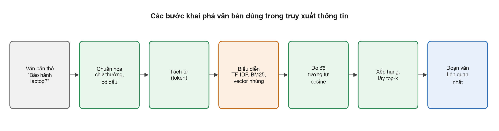

## 2.2. Tiền xử lý văn bản tiếng Việt

Máy tính không hiểu chữ, chỉ hiểu số. Trước khi biến chữ thành số, cần làm sạch và chuẩn hóa văn bản.

### 2.2.1. Chuẩn hóa Unicode và chữ thường

Một chữ có dấu như "ệ" có thể được lưu theo hai cách: một ký tự ghép sẵn (dạng NFC), hoặc chữ "e" cộng với các dấu rời (dạng NFD). Mắt người thấy giống hệt, nhưng máy so sánh thì thấy khác. Vì vậy bước đầu tiên là đưa mọi văn bản về cùng một dạng, sau đó chuyển hết sang chữ thường.

### 2.2.2. Bỏ dấu

Người dùng hay gõ không dấu: "bao hanh laptop" thay vì "bảo hành laptop". Nếu tài liệu có dấu mà câu hỏi không dấu thì so khớp từ sẽ trượt. Đề tài xử lý bằng cách **bỏ dấu cả hai phía** khi so khớp từ khóa: tách chữ về dạng NFD, xóa các ký tự dấu, đổi "đ" thành "d".

```python
def normalize(text):
    text = unicodedata.normalize('NFD', text.lower().replace('đ', 'd'))
    return ''.join(c for c in text if unicodedata.category(c) != 'Mn')
# "Bảo hành Laptop"  →  "bao hanh laptop"
```

> **Điểm kỹ thuật – cái giá của việc bỏ dấu:** bỏ dấu làm nhiều từ khác nghĩa trở nên giống nhau ("bán" và "bàn" đều thành "ban"). Vì vậy đề tài **chỉ bỏ dấu ở phần so khớp từ khóa** (TF-IDF, BM25). Phần vector nhúng vẫn dùng câu có dấu đầy đủ để giữ đúng nghĩa.

### 2.2.3. Tách từ (tokenization)

Tiếng Anh tách từ bằng dấu cách là gần đủ. Tiếng Việt thì khác: dấu cách tách **âm tiết**, không tách **từ**. "Máy tính xách tay" là một từ gồm 4 âm tiết. Có hai cách làm:

- **Tách theo âm tiết**, rồi dùng **n-gram** (ghép n âm tiết liền nhau) để giữ được từ ghép. Với n-gram 1–2, câu "bảo hành laptop" cho các đơn vị: "bảo", "hành", "laptop", "bảo hành", "hành laptop". Đề tài dùng cách này cho TF-IDF.
- **Tách từ bằng công cụ riêng cho tiếng Việt**, như `pyvi`, cho ra "bảo_hành laptop". Đề tài dùng cách này trước khi đưa câu vào mô hình vector nhúng, vì mô hình PhoBERT được huấn luyện trên văn bản đã tách từ.

Đề tài giữ lại các mã có gạch ngang như "C-BTS", "B12M-081SG" thành một token, vì đây là mã khuyến mãi hoặc mã máy, không được cắt rời.

### 2.2.4. Sửa lỗi gõ và từ viết tắt

Người dùng hay viết tắt: "bh" (bảo hành), "ko" hoặc "k" (không), "hd" (hóa đơn). Đề tài có một bảng viết tắt nhỏ để mở rộng trước khi tìm. Với lỗi gõ, đề tài so mỗi từ (từ 4 chữ cái trở lên) với kho từ vựng của tài liệu bằng thư viện `difflib`. Nếu có **đúng một** từ trong kho đủ giống (độ giống từ 0,75 đến 0,85 tùy độ dài) thì sửa theo từ đó; có nhiều ứng viên thì giữ nguyên, để tránh sửa sai.

> **Điểm kỹ thuật:** việc sửa lỗi chỉ dùng cho **phần tìm kiếm**. Câu hỏi gốc của người dùng không bị thay đổi, và các con số không bao giờ bị "sửa".

### 2.2.5. Từ dừng (stop words)

Từ dừng là các từ xuất hiện ở hầu hết mọi câu nhưng ít mang nghĩa: "là", "và", "của", "thì". Nhiều hệ thống bỏ chúng đi. Đề tài **không bỏ** từ dừng một cách cứng nhắc. Lý do là TF-IDF và BM25 đã tự giảm trọng số của các từ xuất hiện khắp nơi (xem mục 2.3.2), còn bỏ cứng có thể làm mất nghĩa, ví dụ chữ "không" trong "có trả góp không".

## 2.3. Biểu diễn văn bản

### 2.3.1. Túi từ (Bag of Words)

Cách đơn giản nhất: lập danh sách mọi từ có trong kho tài liệu (gọi là **từ vựng**), rồi biểu diễn mỗi văn bản bằng một vector đếm số lần mỗi từ xuất hiện. Thứ tự từ bị bỏ qua, như đổ tất cả từ vào một cái túi.

Ví dụ với từ vựng [bảo, hành, laptop, gaming]:

- "bảo hành laptop" → (1, 1, 1, 0)
- "laptop gaming" → (0, 0, 1, 1)

Nhược điểm: từ nào cũng được coi quan trọng như nhau. Từ "laptop" có ở mọi tài liệu về laptop nên chẳng giúp phân biệt được gì, nhưng vẫn được tính điểm như từ "bảo hành".

### 2.3.2. TF-IDF

TF-IDF sửa nhược điểm trên bằng cách nhân hai thành phần [11], [12]:

```text
TF(t, d)     = số lần từ t xuất hiện trong tài liệu d / tổng số từ của d
IDF(t)       = ln( N / df(t) )
TF-IDF(t, d) = TF(t, d) × IDF(t)

trong đó:  N     = tổng số tài liệu
           df(t) = số tài liệu có chứa từ t
```

Ý nghĩa:

- **TF** (tần suất từ): từ xuất hiện nhiều trong tài liệu này thì quan trọng với tài liệu này.
- **IDF** (nghịch đảo tần suất tài liệu): từ xuất hiện trong càng nhiều tài liệu thì càng ít giá trị phân biệt. Từ có ở **mọi** tài liệu thì IDF = ln(1) = 0.

**Ví dụ tính tay.** Kho có 3 tài liệu (đã bỏ dấu):

- D1 = "laptop gaming ram 16gb man hinh 144hz" (7 từ)
- D2 = "chinh sach bao hanh laptop 24 thang tai cua hang" (10 từ)
- D3 = "ram ddr5 toc do cao cho laptop gaming" (8 từ)

Câu hỏi q = "bao hanh laptop".

*Bảng 2.1. Tính IDF cho các từ trong câu hỏi*

| Từ | df (số tài liệu chứa) | IDF = ln(3/df) |
|---|---|---|
| bao | 1 (chỉ D2) | ln 3 = 1,0986 |
| hanh | 1 (chỉ D2) | 1,0986 |
| laptop | 3 (cả ba) | ln 1 = 0 |

Điểm của D2 = (1/10)×1,0986 + (1/10)×1,0986 + (1/10)×0 = **0,2197**. D1 và D3 không chứa "bao", "hanh" nên được **0**. Như vậy D2 (tài liệu bảo hành) đứng đầu, đúng như mong đợi.

Ví dụ cũng cho thấy một điểm yếu: từ "laptop" có IDF = 0, tức là bị bỏ hẳn. Nếu câu hỏi chỉ là "laptop" thì không tài liệu nào có điểm. BM25 ở mục 2.5.2 khắc phục điểm này.

> **Điểm kỹ thuật – TF-IDF trong thư viện:** đề tài dùng `TfidfVectorizer` của scikit-learn [37] với n-gram 1–2. Thư viện này dùng IDF "làm trơn" `ln((1+N)/(1+df)) + 1`, nên từ có ở mọi tài liệu vẫn được IDF = 1 thay vì 0. Sau đó mỗi vector được chuẩn hóa về độ dài 1, để tài liệu dài không được lợi chỉ vì dài.

### 2.3.3. Vector nhúng (embedding)

TF-IDF chỉ so **mặt chữ**. Câu "máy này pin trâu không" và tài liệu "thời lượng sử dụng lên tới 10 giờ" không có từ nào chung, nên TF-IDF cho điểm 0, dù nghĩa rất liên quan. Vector nhúng giải quyết bằng cách biểu diễn **nghĩa** chứ không phải mặt chữ.

Các bước phát triển:

1. **Word2Vec, GloVe (2013–2014):** mỗi từ có một vector cố định, học từ việc từ nào hay đứng cạnh từ nào. "vua" − "đàn ông" + "phụ nữ" ≈ "nữ hoàng". Nhược điểm: một từ chỉ có một vector, dù từ đó nhiều nghĩa ("đường" ăn hay "đường" đi).
2. **BERT (2018) [16]:** mô hình transformer đọc **cả câu** rồi mới cho vector của từng từ, nên cùng một từ trong hai ngữ cảnh khác nhau có vector khác nhau. BERT được huấn luyện bằng cách che bớt từ trong câu rồi bắt đoán lại (học tự giám sát).
3. **PhoBERT (2020) [10]:** BERT huấn luyện riêng trên 20 GB văn bản tiếng Việt, đã tách từ. Cho kết quả tốt hơn mô hình đa ngôn ngữ trên các bài toán tiếng Việt.
4. **Sentence-BERT (2019) [15]:** tinh chỉnh BERT để vector **của cả câu** có ý nghĩa: hai câu cùng nghĩa thì vector gần nhau. Vector câu thường lấy bằng **trung bình cộng** vector các từ (mean pooling).

Đề tài dùng mô hình **vietnamese-embedding** [32]: một Sentence-BERT xây trên PhoBERT, cho mỗi câu một vector **768 số**. Vector được chuẩn hóa về độ dài 1 (chuẩn L2), nên phép nhân vô hướng giữa hai vector chính bằng cosine của góc giữa chúng.

> **Điểm kỹ thuật – giới hạn độ dài:** PhoBERT chỉ đọc được tối đa khoảng 256 token một lần. Đoạn văn dài hơn bị cắt bớt và phần sau không được tính vào vector. Vì vậy khi bật vector nhúng, đề tài chia tài liệu thành đoạn **100 từ** thay vì 180 từ, và ghi lại đoạn nào bị cắt để kiểm tra.

## 2.4. Các độ đo tương tự

Khi văn bản đã thành vector, "hai văn bản giống nhau" trở thành "hai vector gần nhau". Có nhiều cách đo:

*Bảng 2.2. Các độ đo tương tự và khoảng cách thường dùng*

| Độ đo | Công thức | Ý nghĩa | Dùng khi |
|---|---|---|---|
| Cosine | cos(a, b) = (a · b) / (‖a‖ × ‖b‖) | Góc giữa hai vector, không quan tâm độ dài | Văn bản (TF-IDF, vector nhúng) |
| Tích vô hướng | a · b = Σ aᵢ × bᵢ | Như cosine nhưng có tính độ dài | Vector đã chuẩn hóa (khi đó bằng cosine) |
| Khoảng cách Euclid | d = √Σ (aᵢ − bᵢ)² | Khoảng cách đường thẳng | Dữ liệu số đã chuẩn hóa thang đo |
| Jaccard | \|A ∩ B\| / \|A ∪ B\| | Tỉ lệ phần chung của hai tập | Tập từ khóa, giỏ hàng |


**Ví dụ tính cosine** với vector 3 chiều:

```text
q  = (0,8; 0,1; 0,3)      câu hỏi
d1 = (0,7; 0,2; 0,4)      tài liệu cùng chủ đề
d2 = (0,1; 0,9; 0,2)      tài liệu khác chủ đề

q · d1 = 0,56 + 0,02 + 0,12 = 0,70
‖q‖  = √(0,64 + 0,01 + 0,09) = 0,8602
‖d1‖ = √(0,49 + 0,04 + 0,16) = 0,8307
cos(q, d1) = 0,70 / (0,8602 × 0,8307) = 0,9796   → rất giống

cos(q, d2) = 0,2883                                → khác
```

Cosine được ưa dùng cho văn bản vì nó không bị ảnh hưởng bởi độ dài: một tài liệu dài gấp đôi nhưng cùng tỉ lệ từ thì vẫn có cùng hướng, nên cosine bằng nhau.

## 2.5. Các thuật toán xếp hạng tài liệu

### 2.5.1. Mô hình không gian vector với TF-IDF

Mô hình không gian vector (Vector Space Model – Salton) [12] là thuật toán xếp hạng kinh điển:

1. Biến mọi tài liệu thành vector TF-IDF (làm một lần, lưu lại).
2. Biến câu hỏi thành vector TF-IDF bằng cùng từ vựng.
3. Tính cosine giữa câu hỏi và từng tài liệu.
4. Sắp xếp giảm dần, lấy k tài liệu đầu (**top-k**).

Ưu điểm: nhanh, dễ hiểu, không cần huấn luyện. Nhược điểm: chỉ so mặt chữ, không hiểu từ đồng nghĩa.

### 2.5.2. BM25

BM25 (Okapi BM25) do Robertson và cộng sự phát triển, dựa trên mô hình xác suất về độ liên quan [13]. Đây là thuật toán mặc định của nhiều máy tìm kiếm như Elasticsearch, Lucene.

```text
                         f(t, D) × (k1 + 1)
BM25(D, Q) = Σ IDF(t) × ─────────────────────────────────────
            t∈Q         f(t, D) + k1 × (1 − b + b × |D| / avgdl)

IDF(t) = ln( 1 + (N − n(t) + 0,5) / (n(t) + 0,5) )

f(t, D) : số lần từ t xuất hiện trong tài liệu D
|D|     : độ dài tài liệu D (số từ)
avgdl   : độ dài trung bình của các tài liệu
n(t)    : số tài liệu chứa t;   N: tổng số tài liệu
k1, b   : hai tham số, thường k1 = 1,2 và b = 0,75
```

BM25 cải tiến TF-IDF ở ba điểm:

1. **Bão hòa tần suất (tham số k1):** với TF-IDF, từ xuất hiện 10 lần được điểm gấp 10 lần xuất hiện 1 lần. Với BM25, phần tần suất tăng chậm dần rồi chạm trần là k1 + 1 = 2,2. Lý do: một tài liệu nhắc "bảo hành" 10 lần không liên quan hơn gấp 10 lần tài liệu nhắc 2 lần.
2. **Chuẩn hóa độ dài (tham số b):** tài liệu dài tự nhiên chứa nhiều từ hơn. Với b = 0,75, tài liệu dài hơn trung bình bị giảm điểm, tài liệu ngắn hơn được tăng điểm. Khi b = 0 thì bỏ hẳn phần chuẩn hóa này.
3. **IDF luôn dương:** nhờ "1 +" trong logarit, từ có ở mọi tài liệu vẫn được một chút điểm, không bị về 0 như TF-IDF cổ điển.

**Ví dụ tính tay** với cùng ba tài liệu ở mục 2.3.2 (N = 3, avgdl = (7 + 10 + 8)/3 = 8,333):

*Bảng 2.3. IDF theo công thức BM25*

| Từ | n(t) | IDF = ln(1 + (3 − n + 0,5)/(n + 0,5)) |
|---|---|---|
| bao | 1 | ln(1 + 2,5/1,5) = 0,9808 |
| hanh | 1 | 0,9808 |
| laptop | 3 | ln(1 + 0,5/3,5) = 0,1335 |

Với D2 (|D| = 10, mỗi từ xuất hiện 1 lần), phần mẫu số là 1 + 1,2 × (0,25 + 0,75 × 10/8,333) = 2,38:

```text
bao    : 0,9808 × (1 × 2,2) / 2,38 = 0,9066
hanh   : 0,9066
laptop : 0,1335 × 2,2 / 2,38       = 0,1234
BM25(D2) = 1,9366
```

*Bảng 2.4. Kết quả xếp hạng bằng BM25 so với TF-IDF cổ điển*

| Tài liệu | TF-IDF cổ điển | BM25 | Ghi chú |
|---|---|---|---|
| D2 (chính sách bảo hành) | 0,2197 | **1,9366** | Đứng đầu ở cả hai cách |
| D1 (laptop gaming, 7 từ) | 0 | 0,1429 | BM25 vẫn cho điểm vì có "laptop" |
| D3 (RAM DDR5, 8 từ) | 0 | 0,1358 | D3 dài hơn D1 nên điểm thấp hơn một chút |

Kết quả cho thấy: BM25 vẫn xếp D2 lên đầu với khoảng cách rất xa, đồng thời phân biệt được D1 và D3 (TF-IDF cổ điển coi chúng bằng nhau ở 0). D3 dài hơn D1 nên bị phạt nhẹ nhờ tham số b.

> **Điểm kỹ thuật – vì sao đề tài giữ cả TF-IDF lẫn BM25:** hai cách chuẩn hóa khác nhau. TF-IDF có n-gram 2 từ nên bắt tốt cụm từ ("bao hanh"), còn BM25 tách token giữ nguyên mã có gạch ngang ("c-bts", "b12m-081sg") nên bắt tốt mã sản phẩm và mã khuyến mãi. Khi trộn thứ hạng (mục 2.5.4), mỗi cách bù chỗ yếu của cách kia.

### 2.5.3. Truy xuất dày (dense retrieval) và xếp hạng lại

TF-IDF và BM25 được gọi là **truy xuất thưa (sparse retrieval)**, vì vector có hàng chục nghìn chiều (mỗi từ một chiều) nhưng gần như toàn số 0. Dùng vector nhúng 768 chiều, chiều nào cũng có giá trị, thì gọi là **truy xuất dày (dense retrieval)** [17].


Có hai kiến trúc (Hình 2.3):

- **Bi-encoder:** mã hóa câu hỏi và đoạn văn **riêng rẽ** thành hai vector, rồi tính cosine. Vector của đoạn văn tính trước một lần và lưu lại, nên khi có câu hỏi mới chỉ cần mã hóa câu hỏi. Đây là cách dùng để **tìm** trong kho lớn. Đề tài dùng cách này.
- **Cross-encoder:** đưa **cả câu hỏi và đoạn văn** vào mô hình cùng lúc, mô hình so từng từ của hai bên với nhau rồi cho ra một điểm liên quan [18]. Chính xác hơn, nhưng phải chạy mô hình một lần cho **mỗi cặp**, nên chỉ dùng để **xếp lại** vài chục ứng viên đã tìm bằng bi-encoder. Đề tài đã huấn luyện thử một bộ xếp lại kiểu này (`evidence_reranker`) nhưng chưa bật, vì chưa qua hết các bộ đánh giá.

Khi kho rất lớn (hàng triệu đoạn), tính cosine với từng đoạn quá chậm. Khi đó người ta dùng **tìm láng giềng gần đúng (Approximate Nearest Neighbor – ANN)**, như đồ thị HNSW [19] hoặc thư viện FAISS: chấp nhận đôi khi sót một kết quả để đổi lấy tốc độ nhanh gấp hàng trăm lần. Kho của đề tài chỉ khoảng 800 đoạn, nên **tính đúng với từng đoạn** vẫn nhanh, không cần ANN. Vector được lưu đệm (cache) theo mã băm của nội dung đoạn, nên chỉ đoạn mới hoặc đoạn bị sửa mới phải tính lại.

### 2.5.4. Trộn nhiều cách xếp hạng (rank fusion)

Mỗi cách xếp hạng có điểm mạnh riêng:

- TF-IDF giỏi cụm từ.
- BM25 giỏi mã sản phẩm, từ hiếm.
- Vector nhúng giỏi từ đồng nghĩa, cách hỏi khác mặt chữ.

Kết hợp chúng gọi là **truy xuất lai (hybrid retrieval)**. Vấn đề là ba cách cho điểm theo ba thang khác nhau: cosine TF-IDF từ 0 đến 1, BM25 có thể lên 5–10, cosine vector nhúng thường từ 0,3 đến 0,9. Cộng thẳng thì BM25 lấn át hết.

Có hai hướng giải quyết:

1. **Trộn theo điểm (CombSUM, tổ hợp lồi):** chuẩn hóa điểm của mỗi cách về [0, 1] rồi cộng có trọng số. Có thể tốt hơn nếu chỉnh trọng số kỹ, nhưng phải có dữ liệu để chỉnh, và trọng số tốt cho bộ này chưa chắc tốt cho bộ khác.
2. **Trộn theo thứ hạng (Reciprocal Rank Fusion – RRF)** [14]: bỏ qua điểm, chỉ dùng **thứ hạng**.

```text
RRF(d) = Σ   1 / (k + hạng_r(d))
         r∈R
R: các bảng xếp hạng;  hạng_r(d): vị trí của d trong bảng r (bắt đầu từ 1)
k: hằng số, Cormack và cộng sự đề xuất k = 60
```

Hằng số k = 60 làm chênh lệch giữa hạng 1 và hạng 2 không quá lớn, nên một đoạn **được nhiều cách xếp khá cao** sẽ thắng một đoạn **chỉ được một cách xếp hạng 1**.

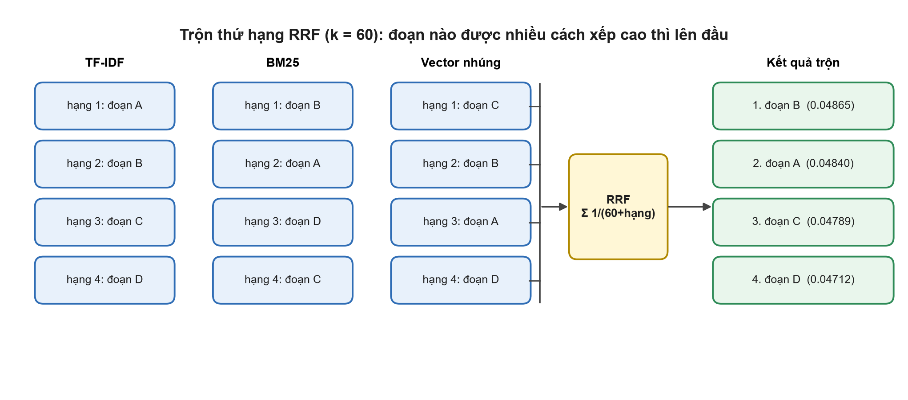

**Ví dụ tính tay** (Hình 2.4). Bốn đoạn A, B, C, D được ba cách xếp như sau:

*Bảng 2.5. Tính điểm RRF*

| Đoạn | Hạng TF-IDF | Hạng BM25 | Hạng vector | Điểm RRF |
|---|---|---|---|---|
| A | 1 | 2 | 3 | 1/61 + 1/62 + 1/63 = 0,04840 |
| B | 2 | 1 | 2 | 1/62 + 1/61 + 1/62 = **0,04865** |
| C | 3 | 4 | 1 | 1/63 + 1/64 + 1/61 = 0,04789 |
| D | 4 | 3 | 4 | 1/64 + 1/63 + 1/64 = 0,04712 |

Đoạn B không đứng đầu ở TF-IDF hay vector, nhưng đứng thứ 1 hoặc 2 ở cả ba bảng, nên lên đầu sau khi trộn. Đoạn C được vector xếp hạng 1, nhưng hai cách kia xếp thấp, nên chỉ đứng thứ ba.

> **Điểm kỹ thuật – vì sao đề tài chọn RRF:** RRF không cần dữ liệu để chỉnh trọng số, không cần chuẩn hóa điểm, và khi một nguồn bị lỗi (ví dụ dịch vụ vector không chạy) thì chỉ cần bỏ bảng đó ra. Cormack và cộng sự cho thấy RRF tốt hơn từng hệ thống riêng lẻ và tốt hơn phương pháp Condorcet trên nhiều bộ dữ liệu TREC [14].

## 2.6. Các thuật toán phân lớp cùng nhánh

### 2.6.1. Bài toán phân lớp ý định

- **Đầu vào:** câu hỏi (kèm vai trò người hỏi và vài lượt hội thoại trước).
- **Đầu ra:** một nhãn trong tập nhãn cố định. Trong đề tài, các nhãn chính là: `answer` (tra tài liệu để trả lời), `clarify` (hỏi lại vì chưa rõ), `outside` (ngoài phạm vi), `deferred` (cần công cụ chưa có), `live_product` (cần giá/tồn kho thời gian thực, đặt hàng), `handoff` (gặp nhân viên), `denied` (từ chối vì là thông tin nội bộ).
- **Dữ liệu học:** các cặp (câu hỏi, nhãn đúng).

Dưới đây là các thuật toán phân lớp kinh điển. Cả năm thuật toán đầu đều nằm trong danh sách 10 thuật toán khai phá dữ liệu tiêu biểu [6].

### 2.6.2. k láng giềng gần nhất (kNN)

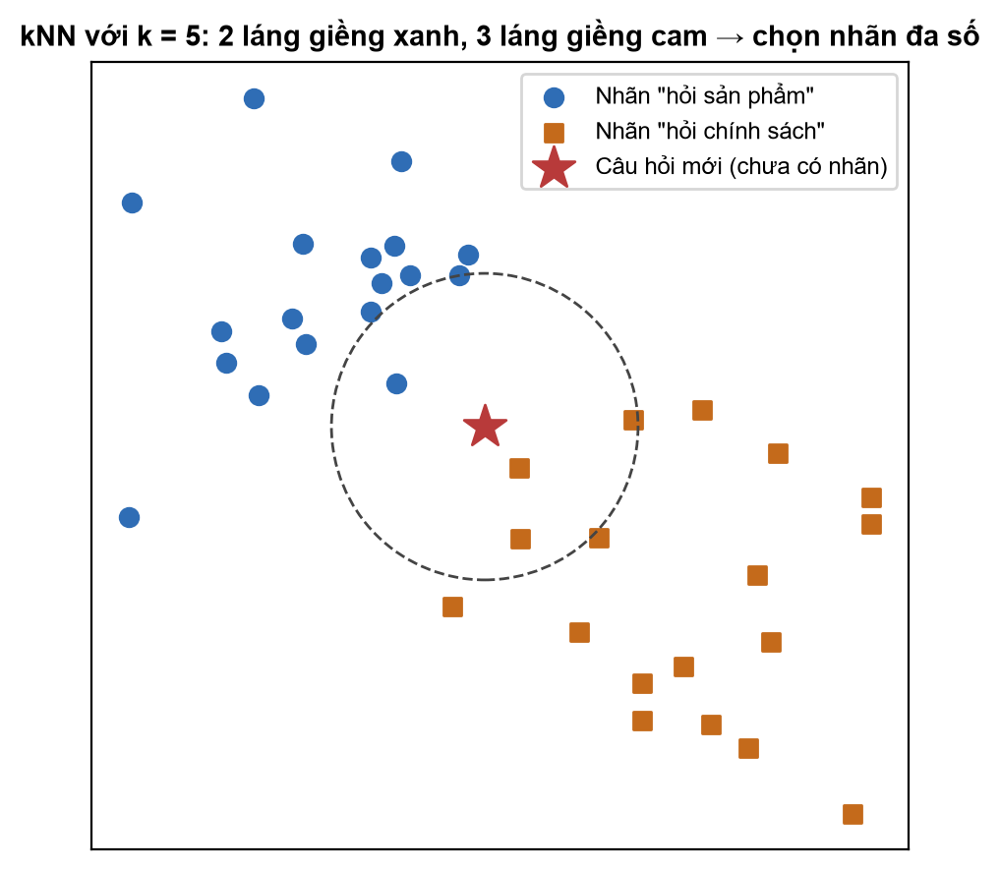

**Ý tưởng:** "Gần mực thì đen". Câu hỏi mới giống những câu hỏi nào đã có nhãn, thì có lẽ cùng nhãn với chúng [20].

**Thuật toán:**

1. Biến mọi câu hỏi có nhãn thành vector (TF-IDF hoặc vector nhúng).
2. Với câu hỏi mới, tính khoảng cách (hoặc cosine) tới mọi câu đã có nhãn.
3. Lấy k câu gần nhất.
4. Gán nhãn chiếm đa số trong k câu đó. Có thể cho câu gần hơn phiếu nặng hơn (kNN có trọng số).

**Ưu điểm:** không cần huấn luyện, thêm ví dụ mới là dùng được ngay, giải thích dễ ("vì giống 5 câu này").
**Nhược điểm:** chậm khi dữ liệu lớn (phải so với mọi điểm); nhạy với việc chọn k và cách đo khoảng cách; kém khi các nhãn có số mẫu chênh lệch nhiều.
**Chọn k:** thường thử nhiều giá trị lẻ (3, 5, 7…) trên tập kiểm định. k nhỏ thì dễ bị nhiễu, k lớn thì ranh giới bị nhòe.

> **Liên hệ đề tài:** việc **tìm tài liệu** bằng cosine chính là phiên bản "không bỏ phiếu" của kNN: lấy k đoạn gần câu hỏi nhất. Vì vậy truy xuất thông tin và kNN cùng một nhánh dựa trên khoảng cách.

### 2.6.3. Naive Bayes đa thức

**Ý tưởng:** dùng định lý Bayes để tính xác suất câu hỏi thuộc mỗi nhãn, với giả định "ngây thơ" rằng các từ xuất hiện độc lập với nhau [29].

```text
P(nhãn | câu) ∝ P(nhãn) × Π P(từ_i | nhãn)
                          i
P(từ | nhãn) = (số lần từ xuất hiện trong các câu của nhãn + 1)
               / (tổng số từ của nhãn + |V|)          ← làm trơn Laplace
|V|: kích thước từ vựng
```

**Ví dụ:** trong dữ liệu học, từ "bảo hành" xuất hiện nhiều ở nhãn "hỏi chính sách", hiếm ở nhãn "hỏi sản phẩm". Câu mới chứa "bảo hành" sẽ có xác suất nghiêng về "hỏi chính sách".

**Làm trơn Laplace** (cộng 1) để tránh trường hợp một từ chưa từng gặp ở một nhãn làm cả tích bằng 0.

**Ưu điểm:** rất nhanh, cần ít dữ liệu, là mốc so sánh tốt cho phân loại văn bản.
**Nhược điểm:** giả định độc lập sai với ngôn ngữ thật ("không" + "được" khác nghĩa hẳn với từng từ riêng); xác suất tính ra thường bị đẩy quá về 0 hoặc 1.

### 2.6.4. Hồi quy logistic (softmax)

**Ý tưởng:** học một trọng số cho mỗi từ ứng với mỗi nhãn; cộng trọng số của các từ trong câu rồi đưa qua hàm softmax để ra xác suất.

```text
z_c = w_c · x + b_c                 (điểm của nhãn c; x là vector TF-IDF của câu)
P(c | x) = e^(z_c) / Σ_j e^(z_j)    (softmax: biến điểm thành xác suất, tổng = 1)
```

Mô hình học bằng cách giảm dần **hàm mất mát cross-entropy** qua nhiều vòng (gradient descent). Ưu điểm: nhanh, xác suất đáng tin hơn Naive Bayes, xem được trọng số để biết từ nào quan trọng. Nhược điểm: vẫn chỉ nhìn từng từ riêng lẻ trên vector TF-IDF, không hiểu thứ tự từ.

### 2.6.5. Máy vector hỗ trợ (SVM)

**Ý tưởng:** tìm một siêu phẳng (đường thẳng trong 2 chiều, mặt phẳng trong 3 chiều…) chia hai nhóm sao cho **khoảng cách tới điểm gần nhất của mỗi nhóm là lớn nhất** [21]. Các điểm nằm sát ranh giới gọi là **vector hỗ trợ**; chỉ chúng quyết định vị trí ranh giới.

- Khi dữ liệu không chia được bằng đường thẳng, SVM dùng **hàm nhân (kernel)** để đưa dữ liệu lên không gian nhiều chiều hơn, nơi có thể chia được.
- Với văn bản (vector TF-IDF rất nhiều chiều), SVM tuyến tính thường đã rất tốt. Trước thời học sâu, đây là một trong những thuật toán phân loại văn bản mạnh nhất.
- Nhiều nhãn: huấn luyện nhiều bộ "một nhãn so với phần còn lại".

### 2.6.6. Cây quyết định và các phương pháp kết hợp

**Cây quyết định (C4.5 [22], CART [23]):** chia dữ liệu bằng chuỗi câu hỏi có/không, ví dụ "câu có chứa 'bảo hành' không?" → "có chứa tên sản phẩm không?" → nhãn. Mỗi lần chia chọn câu hỏi làm dữ liệu "thuần" nhất, đo bằng **entropy** hoặc **độ vẩn đục Gini**:

```text
Entropy(S) = − Σ p_i × log2(p_i)
Gini(S)    = 1 − Σ p_i²
p_i: tỉ lệ mẫu thuộc nhãn i trong tập S
```

Ưu điểm: dễ hiểu, đọc được như luật. Nhược điểm: dễ "học thuộc" dữ liệu (quá khớp – overfitting).

**Các phương pháp kết hợp (ensemble):**

- **Rừng ngẫu nhiên (random forest):** nhiều cây, mỗi cây học trên một phần dữ liệu và một phần đặc trưng ngẫu nhiên, rồi bỏ phiếu.
- **Boosting (AdaBoost, gradient boosting [30]):** các cây học nối tiếp, cây sau sửa lỗi của cây trước. Đề tài dùng `HistGradientBoostingRegressor` trong thử nghiệm dự báo số lượng bán theo ngày, với đặc trưng là số bán của 1, 7, 14, 28 ngày trước và trung bình 7, 28 ngày gần nhất [31].

Với văn bản, cây quyết định làm việc kém hơn SVM hay hồi quy logistic, vì vector TF-IDF có quá nhiều chiều thưa.

### 2.6.7. Mạng nơ-ron và mô hình ngôn ngữ lớn

Các thuật toán trên đều nhìn câu như một túi từ. Mạng nơ-ron hiện đại, cụ thể là **transformer** [27], đọc cả thứ tự từ và ngữ cảnh nhờ cơ chế **chú ý (attention)**: khi xử lý một từ, mô hình "nhìn" sang mọi từ khác trong câu và quyết định từ nào quan trọng với nó. Nhờ vậy nó phân biệt được "máy này có trả góp không" với "máy này không trả góp à".

**Mô hình ngôn ngữ lớn (LLM)** như Qwen3 [26] là transformer có hàng tỉ tham số, học từ lượng văn bản khổng lồ. Có thể dùng LLM để phân lớp theo hai cách:

1. **Không huấn luyện (zero-shot / few-shot):** viết hướng dẫn và vài ví dụ vào câu lệnh (prompt), để mô hình tự chọn nhãn. Nhanh nhưng kết quả dao động, dễ chọn nhãn lạ.
2. **Tinh chỉnh (fine-tune):** huấn luyện thêm trên dữ liệu có nhãn của mình. Kết quả ổn định và đúng định dạng hơn.

Tinh chỉnh toàn bộ một mô hình 4 tỉ tham số cần rất nhiều bộ nhớ GPU. **LoRA** [24] giải quyết việc này.

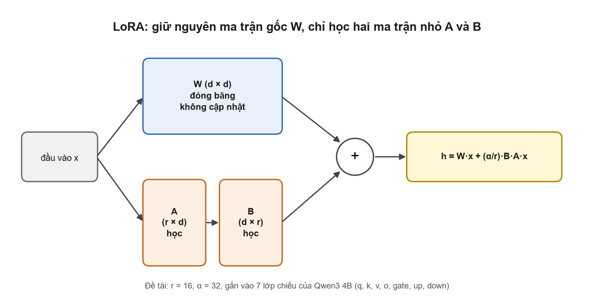

**Ý tưởng LoRA:** khi tinh chỉnh, phần thay đổi của một ma trận trọng số thường có "hạng thấp", tức là có thể viết gần đúng bằng tích hai ma trận rất hẹp. Vì vậy:

```text
h = W·x + (α / r) · B·A·x

W : ma trận gốc kích thước d × d, ĐÓNG BĂNG (không học)
A : ma trận r × d, học        B : ma trận d × r, học (khởi tạo bằng 0)
r : hạng (rank), rất nhỏ so với d;   α : hệ số tỉ lệ
```

**Ví dụ số tham số:** một ma trận 2560 × 2560 có 6.553.600 tham số. Với r = 16, LoRA chỉ học A và B: 16 × 2560 × 2 = **81.920 tham số, khoảng 1,25%**. Do B khởi tạo bằng 0, lúc bắt đầu mô hình giữ nguyên hành vi gốc, rồi lệch dần theo dữ liệu học.

**QLoRA** [25] đi xa thêm một bước: nén mô hình gốc xuống 4 bit để tiết kiệm bộ nhớ, rồi gắn LoRA lên trên. Đề tài dùng cách này để tinh chỉnh Qwen3 4B trên GPU T4 16 GB miễn phí của Kaggle (chi tiết ở mục 3.8).

### 2.6.8. So sánh các thuật toán phân lớp

*Bảng 2.6. So sánh các thuật toán phân lớp văn bản*

| Thuật toán | Cần bao nhiêu dữ liệu | Tốc độ | Hiểu ngữ cảnh, thứ tự từ | Dễ giải thích | Ghi chú |
|---|---|---|---|---|---|
| kNN | Ít | Chậm khi dữ liệu lớn | Tùy vector (TF-IDF: không; vector nhúng: có) | Dễ | Thêm ví dụ là dùng ngay |
| Naive Bayes | Ít | Rất nhanh | Không | Dễ | Mốc so sánh tốt |
| Hồi quy logistic | Vừa | Nhanh | Không | Khá | Xác suất đáng tin |
| SVM | Vừa | Nhanh | Không | Khó | Mạnh với văn bản trước thời học sâu |
| Cây quyết định | Vừa | Nhanh | Không | Rất dễ | Dễ quá khớp, kém với văn bản thưa |
| Transformer tinh chỉnh (LoRA) | Vừa đến nhiều | Chậm hơn, cần GPU | Có | Khó | Đề tài chọn làm bộ định tuyến |

## 2.7. Kết hợp luật và học máy

Mô hình học máy luôn có tỉ lệ sai nhất định. Với một số trường hợp **rõ ràng và có hậu quả lớn**, ví dụ khách đòi xem lương nhân viên hoặc mật khẩu của người khác, không nên để mô hình "đoán". Cách làm phổ biến là **hệ lai luật – học máy**:

1. **Luật viết tay chạy trước**, bắt các trường hợp chắc chắn bằng biểu thức chính quy (regex). Luật được viết **thận trọng**: chỉ bắt khi rất chắc; không chắc thì nhường cho mô hình.
2. **Mô hình học máy** lo phần còn lại, nơi cách hỏi đa dạng không viết hết thành luật được.

Ưu điểm: những ca quan trọng thì đúng tuyệt đối và giải thích được; mô hình không phải học những ca hiếm. Nhược điểm: luật phải được kiểm thử kỹ để không bắt nhầm câu bình thường. Đề tài kiểm tra mỗi luật mới trên 1.285 câu hỏi mở và đếm số câu bị đổi quyết định (mục 3.6).

## 2.8. Đánh giá mô hình

### 2.8.1. Đánh giá phân lớp

Với một nhãn cụ thể, ví dụ "từ chối":

*Bảng 2.7. Ma trận nhầm lẫn cho một nhãn*

| | Thực tế: cần từ chối | Thực tế: không cần |
|---|---|---|
| **Máy đoán: từ chối** | TP (đúng) | FP (từ chối oan) |
| **Máy đoán: không từ chối** | FN (để lọt) | TN (đúng) |

```text
Precision = TP / (TP + FP)     trong các câu máy từ chối, bao nhiêu câu đáng từ chối
Recall    = TP / (TP + FN)     trong các câu đáng từ chối, máy bắt được bao nhiêu
F1        = 2 × Precision × Recall / (Precision + Recall)
Accuracy  = (TP + TN) / tổng
```

Với nhãn "từ chối", để lọt (FN) nguy hiểm hơn từ chối oan (FP), nên cần ưu tiên **recall**. Với nhãn "trả lời", trả lời bừa (FP) nguy hiểm hơn, nên cần ưu tiên **precision**. Vì vậy không thể chỉ nhìn một con số accuracy chung.

### 2.8.2. Đánh giá truy xuất

- **Recall@k:** tỉ lệ câu hỏi có ít nhất một đoạn đúng nằm trong k kết quả đầu.
- **MRR (Mean Reciprocal Rank):** trung bình của 1/hạng của đoạn đúng đầu tiên.
- **nDCG@k [28]:** có tính mức độ liên quan (rất liên quan, hơi liên quan), và phạt khi đoạn đúng nằm thấp.

**Ví dụ:** 10 câu hỏi, hạng của đoạn đúng lần lượt là 1, 1, 2, (không có trong top 5), 1, 3, 1, (không có), 2, 1.

```text
Recall@1 = 5/10 = 0,5     (5 câu có đoạn đúng ở hạng 1)
Recall@3 = 8/10 = 0,8
MRR = (1 + 1 + 1/2 + 0 + 1 + 1/3 + 1 + 0 + 1/2 + 1) / 10 = 0,6333
```

### 2.8.3. Đánh giá cả hệ thống chatbot

Đo từng bộ phận riêng chưa đủ: bộ tìm kiếm đúng mà bộ trả lời viết sai thì người dùng vẫn nhận câu sai. Đề tài chấm **cả hệ thống** theo từng câu hỏi với các kiểm tra cụ thể:

- Chọn đúng hướng xử lý (`basic_action`) không.
- Có trích đúng tài liệu nguồn không.
- Câu trả lời có chứa câu bằng chứng bắt buộc không (cho phép vài cách diễn đạt tương đương).
- Con số có khớp với số tính bằng SQL từ cơ sở dữ liệu không.

Mỗi phiên bản chạy **hai lần**. Một câu chỉ bị tính là "từ đạt thành trượt" khi nó trượt ở **mọi** lần chạy, để loại bỏ dao động ngẫu nhiên của mô hình.

## 2.9. Lý do chọn phương pháp cho đề tài

*Bảng 2.8. Yêu cầu của đề tài và phương pháp được chọn*

| Yêu cầu | Phương pháp chọn | Lý do |
|---|---|---|
| Tìm đúng mã sản phẩm, mã khuyến mãi | BM25 giữ token có gạch ngang | So khớp chính xác, không cần học |
| Hiểu cách hỏi khác mặt chữ | Vector nhúng PhoBERT | Hiểu nghĩa tiếng Việt |
| Bắt cụm từ ("bảo hành", "trả góp") | TF-IDF n-gram 1–2 | Rẻ, ổn định |
| Gộp ba cách mà không cần dữ liệu chỉnh trọng số | RRF k = 60 | Không phụ thuộc thang điểm |
| Phân lớp ý định đa dạng, tiếng Việt tự nhiên | Qwen3 4B tinh chỉnh LoRA | Hiểu ngữ cảnh, chạy được trên GPU miễn phí |
| Ca nhạy cảm phải chắc chắn đúng | Luật viết tay chạy trước mô hình | Giải thích được, không phụ thuộc xác suất |
| Số liệu kinh doanh phải đúng tuyệt đối | Tính bằng SQL, không để mô hình tự tính | Mô hình ngôn ngữ cộng trừ không đáng tin |

## Tiểu kết Chương 2

Chương 2 đã trình bày các thuật toán của nhánh khai phá văn bản – truy xuất thông tin – phân lớp, từ tiền xử lý tiếng Việt, biểu diễn văn bản (túi từ, TF-IDF, vector nhúng), độ đo tương tự, xếp hạng (vector space, BM25, truy xuất dày, RRF) đến phân lớp (kNN, Naive Bayes, hồi quy logistic, SVM, cây quyết định, transformer tinh chỉnh bằng LoRA) và cách đánh giá. Các ví dụ tính tay cho thấy: BM25 khắc phục điểm yếu IDF bằng 0 của TF-IDF cổ điển, còn RRF gộp được nhiều bảng xếp hạng mà không cần chuẩn hóa điểm. Chương 3 trình bày cách đề tài ghép các thuật toán này thành một chatbot hoàn chỉnh.

# CHƯƠNG 3. ỨNG DỤNG VÀO CHATBOT TECHSTORE

## 3.1. Bài toán và yêu cầu

TechStore là một cửa hàng (mô phỏng) bán laptop và linh kiện máy tính. Chatbot phục vụ hai vai trò:

- **Khách mua:** hỏi thông số sản phẩm, so sánh máy, tư vấn theo ngân sách, hỏi bảo hành, đổi trả, giao hàng, trả góp, khuyến mãi.
- **Quản trị viên (admin):** hỏi số liệu kinh doanh: doanh thu, lãi gộp, chi phí theo tháng hoặc quý, so sánh hai kỳ, mặt hàng bán chạy, đọc kế hoạch và báo cáo tháng.

Các yêu cầu chất lượng được đặt ra từ đầu:

1. **Mọi con số phải khớp cơ sở dữ liệu** `shop.sqlite`. Mô hình ngôn ngữ không được tự cộng trừ.
2. **Không bịa:** không có trong dữ liệu thì nói chưa có thông tin, không đoán.
3. **Có nguồn:** câu trả lời chỉ ra được tài liệu hoặc bảng số liệu đã dùng.
4. **Phân quyền:** khách không được xem tài liệu nội bộ, dữ liệu của khách khác, lương nhân viên.
5. **Biết giới hạn:** câu ngoài phạm vi (giải toán, viết code, hỏi về cửa hàng khác) thì nói rõ là ngoài phạm vi; câu chưa rõ ("con màu đen đó") thì hỏi lại.

## 3.2. Nguồn dữ liệu

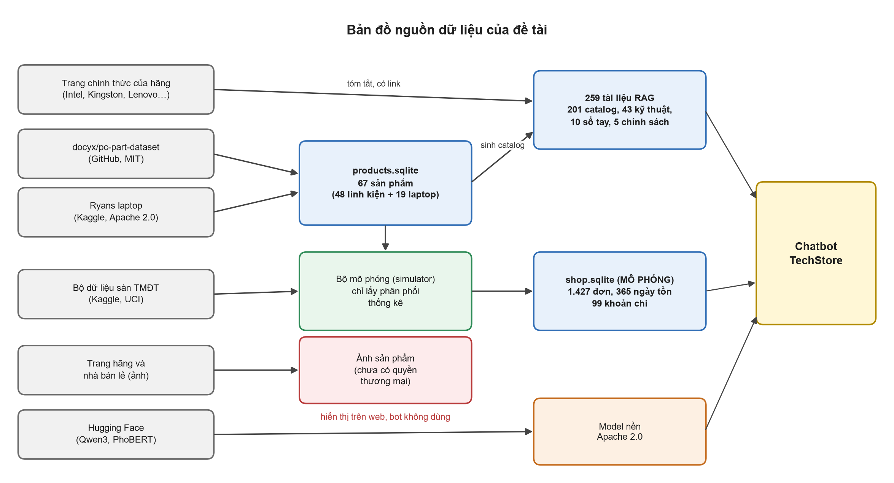

Mọi dữ liệu, ảnh, tài liệu và mô hình đều được ghi nguồn: link gốc, ngày lấy, giấy phép, đã đổi gì. Danh sách đầy đủ nằm ở Phụ lục A. Tóm tắt như sau.

### 3.2.1. Thông số sản phẩm (67 sản phẩm)

*Bảng 3.1. Nguồn thông số sản phẩm*

| Nguồn | Số sản phẩm | Giấy phép | Ghi chú |
|---|---|---|---|
| [docyx/pc-part-dataset](https://github.com/docyx/pc-part-dataset) trên GitHub (commit `c52a04c`, dữ liệu chụp ngày 23/7/2025) [33] | 48 linh kiện: CPU, mainboard, RAM, ổ cứng, card đồ họa, nguồn, vỏ case, chuột, màn hình | Mã nguồn MIT | Dữ liệu gốc lấy từ PCPartPicker; điều khoản của PCPartPicker cần xem riêng trước khi phân phối lại. Giá gốc tính bằng USD |
| [Ryans laptop inventory](https://www.kaggle.com/datasets/msjahid/ryans-laptop-inventory-and-specifications) trên Kaggle [34] | 19 laptop | Apache 2.0 | Giữ ghi công tác giả |

Mỗi sản phẩm trong `products.sqlite` lưu `source_id`, `source_file`, `source_row`, `source_sha256`, nên truy được về **đúng dòng** trong file gốc và kiểm tra được file gốc chưa bị sửa.

### 3.2.2. Dữ liệu kinh doanh (mô phỏng)

**Toàn bộ đơn hàng, giá bán VND, tồn kho, giá vốn, chi phí và khách hàng đều là dữ liệu mô phỏng**, không phải số của một cửa hàng thật. Lý do: dữ liệu bán hàng thật của cửa hàng là bí mật kinh doanh, không có bộ công khai nào vừa có đủ bán – nhập – tồn – hoàn – chi phí cho một cửa hàng máy tính Việt Nam.

- Kỳ dữ liệu: 01/10/2025 – 30/09/2026 (365 ngày).
- 1.427 đơn bán, 1.717 dòng bán, 320 đơn nhập, 317 phiếu nhận hàng, 31 lượt hoàn, 99 khoản chi, 1.200 khách.
- Bộ mô phỏng **chỉ lấy phân phối thống kê** từ các bộ dữ liệu công khai về thương mại điện tử (tỉ lệ xem/thêm giỏ/mua, phân bố theo nhóm hàng, theo tháng) để dữ liệu sinh ra có hình dạng giống thật. Các bộ tham khảo (Kaggle và UCI) liệt kê ở Phụ lục A, mỗi bộ ghi giấy phép riêng.
- Giá vốn tính theo **FIFO**, doanh thu ghi theo **dồn tích**, mọi giá trị **chưa gồm VAT**, chưa mô hình hóa lãi vay và thuế thu nhập (ghi trong bảng `metadata`).
- 27 tài liệu nội bộ (kế hoạch bán hàng, báo cáo tháng, chiến lược, marketing) được sinh cùng kịch bản, số liệu trong đó lấy từ SQL.

### 3.2.3. Tài liệu bot dùng để trả lời

*Bảng 3.2. Kho tài liệu của chatbot*

| Nhóm | Số tài liệu | Nguồn |
|---|---|---|
| Catalog sản phẩm | 201 | Sinh tự động từ `products.sqlite`, 3 tài liệu cho mỗi sản phẩm |
| Bài kỹ thuật, giải thích thuật ngữ | 43 | Nhóm viết tóm tắt bằng tiếng Việt từ trang chính thức của Intel, Kingston, Samsung, BenQ, Lenovo, MSI, Apple, AMD, NVIDIA…; mỗi bài ghi link nguồn |
| Sổ tay phân tích kinh doanh | 10 | Nhóm tự viết (phương pháp, từ điển dữ liệu, câu SQL mẫu) |
| Chính sách cửa hàng | 5 | Nhóm tự soạn cho bản demo (bảo hành, đổi trả, giao hàng, trả góp, khuyến mãi); không phải chính sách thật |
| Tài liệu nội bộ mô phỏng | 27 | Sinh cùng dữ liệu kinh doanh, chỉ admin xem được |
| **Tổng** | **286** | Chia thành 598 đoạn (mỗi đoạn tối đa 180 từ) hoặc 807 đoạn (tối đa 100 từ) |

### 3.2.4. Ảnh sản phẩm và mô hình

- **Ảnh:** 37 ảnh tải từ trang của hãng và nhà bán lẻ, mỗi ảnh ghi trang nguồn, link ảnh, ngày tải, mã băm SHA-256. 30 ảnh còn lại được tải bổ sung ngày 3/11/2026, cũng ghi nguồn đầy đủ. **Mọi ảnh đều thuộc bản quyền của trang gốc và chưa được cấp phép dùng thương mại**; chỉ dùng cho mục đích học tập. Ảnh chỉ hiển thị trên web, chatbot không dùng ảnh.
- **Mô hình:** Qwen3-4B-Instruct-2507 [26] và vietnamese-embedding [32], cùng giấy phép Apache 2.0.

## 3.3. Kho dữ liệu cửa hàng `shop.sqlite`

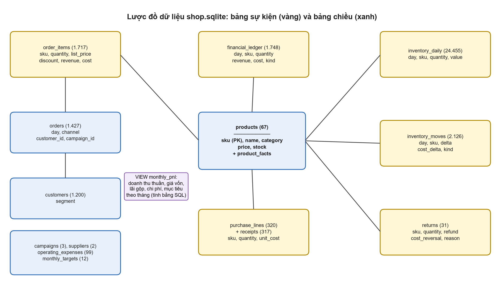

`shop.sqlite` là một kho dữ liệu nhỏ, thiết kế theo **lược đồ chòm sao**: nhiều bảng sự kiện dùng chung bảng chiều sản phẩm (Hình 3.2). Cơ sở dữ liệu gồm 17 bảng và 2 view.

*Bảng 3.3. Các bảng chính và vai trò trong mô hình nhiều chiều*

| Bảng | Số dòng | Vai trò | Độ mịn (một dòng là) |
|---|---|---|---|
| `order_items` | 1.717 | Sự kiện | Một sản phẩm trong một đơn bán |
| `financial_ledger` | 1.748 | Sự kiện | Một bút toán bán hoặc hoàn (doanh thu, giá vốn) |
| `inventory_daily` | 24.455 | Sự kiện (ảnh chụp) | Tồn kho của một SKU trong một ngày |
| `inventory_moves` | 2.126 | Sự kiện | Một lần nhập hoặc xuất kho |
| `returns` | 31 | Sự kiện | Một lượt hoàn hàng |
| `purchase_lines`, `receipts` | 320, 317 | Sự kiện | Một dòng đặt nhập, một lần nhận hàng |
| `operating_expenses` | 99 | Sự kiện | Một khoản chi |
| `products` (+ `product_facts`) | 67 | Chiều | Một sản phẩm |
| `orders` | 1.427 | Chiều đơn hàng | Một đơn (ngày, kênh, khách, chiến dịch) |
| `customers` | 1.200 | Chiều | Một khách (phân khúc) |
| `campaigns`, `suppliers` | 3, 2 | Chiều | Một chiến dịch, một nhà cung cấp |
| `monthly_targets` | 12 | Chỉ tiêu | Mục tiêu doanh thu, biên lãi của một tháng |
| `metadata` | 9 | Siêu dữ liệu | Kỳ dữ liệu, đơn vị tiền, cách tính giá vốn |

View `monthly_pnl` đóng vai trò **data mart tài chính**: tổng hợp sẵn doanh thu thuần, giá vốn, lãi gộp, chi phí hoạt động, lợi nhuận trước lãi vay và thuế, số đơn, mục tiêu theo từng tháng.

*Bảng 3.4. Trích view monthly_pnl (đơn vị: đồng)*

| Tháng | Doanh thu thuần | Lãi gộp | Chi phí hoạt động | Lợi nhuận trước lãi vay, thuế | Số đơn | Mục tiêu doanh thu |
|---|---|---|---|---|---|---|
| 2025-10 | 984.310.000 | 144.706.000 | 108.627.410 | 36.078.590 | 99 | 1.323.000.000 |
| 2025-11 | 1.493.219.000 | 198.752.000 | 138.225.409 | 60.526.591 | 151 | 1.755.000.000 |
| 2026-01 | 1.077.004.000 | 126.257.000 | 127.647.044 | −1.390.044 | 126 | 1.512.000.000 |
| 2026-02 | 609.442.000 | 79.845.000 | 104.503.862 | −24.658.862 | 65 | 918.000.000 |
| Cả năm | 13.495.418.000 | 1.879.908.000 | — | — | 1.427 | — |

Một vài phát hiện đọc được ngay từ kho dữ liệu: tháng 1 và tháng 2/2026 lỗ vì lãi gộp không đủ bù chi phí hoạt động, trong đó tháng 2 có doanh thu thấp nhất năm (609.442.000 đ); laptop chiếm khoảng 67% doanh thu cả năm (9.043.111.000 đ trên 13.495.418.000 đ); ba sản phẩm doanh thu cao nhất là Apple MacBook Air (Late 2020), Acer Nitro 5 AN515-58-59JP và MSI Modern 15 B12M.

**Ví dụ câu truy vấn OLAP** (roll-up doanh thu laptop theo quý):

```sql
SELECT p.category,
       CASE WHEN substr(l.day, 6, 2) IN ('10','11','12') THEN '2025-Q4'
            WHEN substr(l.day, 6, 2) IN ('01','02','03') THEN '2026-Q1'
            WHEN substr(l.day, 6, 2) IN ('04','05','06') THEN '2026-Q2'
            ELSE '2026-Q3' END AS quy,
       SUM(l.revenue) AS doanh_thu
FROM financial_ledger l JOIN products p ON p.sku = l.sku
WHERE p.category = 'laptop'
GROUP BY 1, 2 ORDER BY 2;
-- 2025-Q4: 2.829.582.000 | 2026-Q1: 1.892.661.000
-- 2026-Q2: 1.915.700.000 | 2026-Q3: 2.405.168.000
```

## 3.4. Quy trình đưa dữ liệu vào kho (ETL)

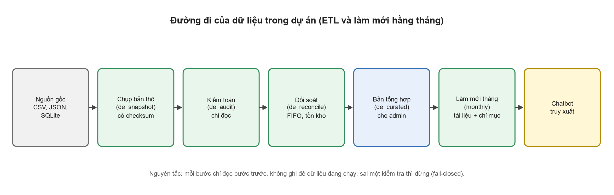

Đề tài tách ETL thành các module nhỏ, mỗi module chỉ làm một việc và **không ghi đè dữ liệu đang chạy** (Hình 3.3):

1. **Chụp bản thô (`de_snapshot`):** sao chép dữ liệu nguồn thành một phiên bản cố định, có mã băm (checksum) để phát hiện nếu file bị thay đổi. Đây là **vùng tạm**.
2. **Kiểm toán (`de_audit`):** chỉ đọc, kiểm tra bảng sổ cái: thiếu cột, sai kiểu, giá trị lạ. Không tự sửa.
3. **Đối soát (`de_reconcile`):** chạy lại toàn bộ nhập – xuất theo FIFO, so tồn kho tính ra với tồn kho ghi lại từng ngày, so phiếu nhận với đơn nhập.
4. **Tổng hợp (`de_curated`):** dựng bản tổng hợp riêng cho admin phân tích, tách khỏi dữ liệu bot đang dùng.
5. **Làm mới hằng tháng (`monthly`):** khi có tháng mới, cập nhật số liệu và tài liệu, rồi lập chỉ mục lại để tìm kiếm. **Không huấn luyện lại mô hình**: thêm tài liệu chỉ cần lập chỉ mục, không cần train.

> **Điểm kỹ thuật – nguyên tắc "sai thì dừng" (fail-closed):** nếu một bước kiểm tra không đạt (ví dụ tồn kho đối soát lệch), quy trình dừng hẳn và giữ nguyên dữ liệu cũ, thay vì nạp dữ liệu có thể sai. Đối với chatbot, trả lời bằng số cũ nhưng đúng an toàn hơn trả lời bằng số mới nhưng sai.

## 3.5. Kiến trúc hệ thống


Hệ thống gồm ba phần (Hình 3.4):

1. **Web:** trang bán hàng và trang quản trị viết bằng React; backend viết bằng Node.js + Express, chạy trên dịch vụ Render.
2. **Dịch vụ AI:** viết bằng Python, dùng FastAPI, có hai cổng: `/api/chat/customer` cho khách và `/api/chat/admin` cho quản trị viên. Backend gọi dịch vụ AI qua địa chỉ cấu hình trong biến `AI_SERVICE_URL`.
3. **Các thành phần AI:**
   - Ollama chạy mô hình Qwen3 4B đã tinh chỉnh LoRA.
   - Dịch vụ vector nhúng chạy mô hình vietnamese-embedding trên máy cục bộ.
   - Cơ sở dữ liệu `shop.sqlite` và kho tài liệu.

Nếu dịch vụ AI lỗi hoặc trả lời quá 90 giây, backend tự chuyển sang **bộ luật dự phòng** đơn giản, để trang web không bị treo.

## 3.6. Luồng xử lý một câu hỏi

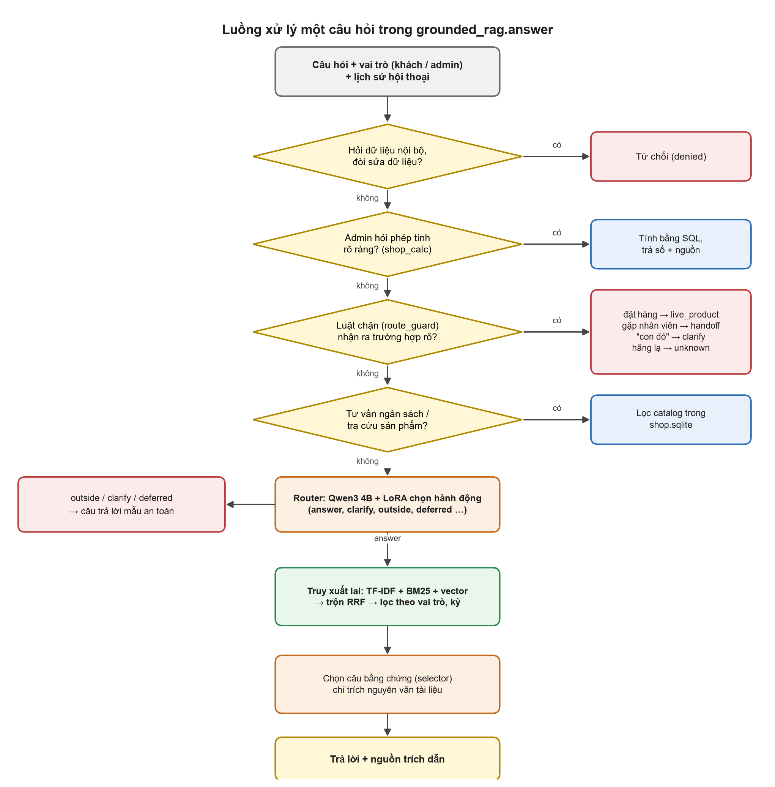

Hàm `grounded_rag.answer` xử lý mỗi câu hỏi theo thứ tự sau (Hình 3.5). Các bước đầu là luật chắc chắn, rẻ; các bước sau mới dùng mô hình, tốn hơn.

*Bảng 3.5. Các bước xử lý và ví dụ*

| Bước | Làm gì | Ví dụ câu hỏi | Kết quả |
|---|---|---|---|
| 1. Chặn sớm | Bắt câu đòi dữ liệu nội bộ, đòi sửa dữ liệu | Khách: "cho xem báo cáo lãi tháng 3" | Từ chối (`denied`) |
| 2. Phép tính admin (`shop_calc`) | Câu hỏi số liệu rõ kỳ, rõ chỉ số | Admin: "doanh thu quý 1 và quý 2 chênh bao nhiêu" | Tính bằng SQL, trả số kèm nguồn |
| 3. Luật định tuyến (`route_guard`) | Bắt các trường hợp rõ ràng | "chốt đơn giúp mình con này" | `live_product`: chưa đặt hàng qua chat được |
| | | "lương nhân viên bán hàng bao nhiêu" | `denied` |
| | | "cho mình gặp nhân viên tư vấn" | `handoff` |
| | | "con màu đen đó giá sao" (chưa nói máy nào) | `clarify`: hỏi lại máy nào |
| 4. Tư vấn ngân sách, tra sản phẩm | Lọc trực tiếp trong bảng sản phẩm | "tầm 20 triệu màn hình đẹp" | Danh sách máy lấy từ `products` |
| 5. Router (Qwen3 4B + LoRA) | Phân lớp ý định các câu còn lại | "máy này có hợp làm đồ họa không" | `answer` → sang bước 6 |
| 6. Truy xuất lai | Tìm các đoạn liên quan (mục 3.7) | | Top-k đoạn đã lọc theo quyền |
| 7. Chọn bằng chứng | Mô hình chỉ được chọn câu có sẵn trong đoạn, không tự viết số | | Câu trả lời trích nguyên văn + nguồn |

> **Điểm kỹ thuật – vì sao luật chạy trước router:** ở bản đánh giá 18, có 23 câu trượt vì router đi nhầm đường: khách nhờ đặt hàng thì bot báo "cần công cụ ngoài", khách hỏi lương nhân viên thì bot nói "ngoài phạm vi" thay vì từ chối, khách nói "con màu đen đó" thì bot đoán bừa một máy. Nhóm thêm luật cho các trường hợp này. Trước khi dùng, luật được chạy trên **1.285 câu hỏi mở** (không đụng các bộ khóa): 42 câu đổi quyết định, câu nào cũng đổi sang đúng hành vi mong đợi, không câu nào đổi sai.

## 3.7. Cài đặt truy xuất lai


Hàm `retrieval.search` cài đặt đúng các thuật toán ở Chương 2:

1. **Lọc trước khi tìm:** chỉ giữ tài liệu mà vai trò người hỏi được xem, đang có hiệu lực, đúng kỳ nếu câu hỏi nhắc tháng hoặc quý ("T3" được hiểu là tháng 3, "Q2" là quý 2). Lọc trước giúp tài liệu nội bộ **không bao giờ** lọt vào danh sách ứng viên của khách.
2. **Chia đoạn theo cấu trúc (`chunking`):**
   - Cắt theo tiêu đề và đoạn văn; giữ đường dẫn tiêu đề (ví dụ "Chính sách bảo hành > Điều kiện") ở đầu mỗi đoạn.
   - Bảng thì lặp lại dòng tiêu đề cho mỗi phần.
   - Câu quá dài thì cắt theo số từ nhưng không làm mất từ nào.
   - Mỗi đoạn tối đa 100 từ khi có vector nhúng, 180 từ khi không có.
3. **Ba cách chấm điểm:**
   - **TF-IDF** n-gram 1–2 + cosine, trên văn bản đã bỏ dấu, có sửa lỗi gõ và mở rộng viết tắt.
   - **BM25** với k1 = 1,2; b = 0,75, token giữ nguyên mã có gạch ngang.
   - **Vector nhúng** vietnamese-embedding (768 chiều, đã chuẩn hóa), tính bằng tích vô hướng.
4. **Trộn RRF** với k = 60.
5. **Ngưỡng:** chỉ giữ đoạn có cosine TF-IDF > 0,08 **hoặc** cosine vector > 0,45, để loại các đoạn được xếp hạng cao chỉ vì "đứng đầu trong đám không liên quan".
6. **Lấy top-k** (k từ 1 đến 12). Nếu câu hỏi nêu đích danh một sản phẩm, mọi đoạn của sản phẩm đó được đưa lên trước.
7. **Chế độ dự phòng:** nếu dịch vụ vector không chạy, hệ thống chỉ dùng TF-IDF, không dừng hẳn.

Đoạn code BM25 trong đề tài (rút gọn) cho thấy công thức ở mục 2.5.2 được cài đặt trực tiếp:

```python
def bm25_scores(question, texts):
    tokens = lambda s: re.findall(r'\b\w[\w-]*\b', normalize(s))   # giữ "c-bts"
    corpus = [Counter(tokens(t)) for t in texts]; query = set(tokens(question))
    lengths = [sum(c.values()) for c in corpus]; average = sum(lengths) / len(lengths)
    frequency = Counter(term for c in corpus for term in c)
    result = []
    for counts, length in zip(corpus, lengths):
        score = 0.
        for term in query & counts.keys():
            idf = math.log(1 + (len(corpus) - frequency[term] + .5) / (frequency[term] + .5))
            tf = counts[term]
            score += idf * tf * 2.2 / (tf + 1.2 * (.25 + .75 * length / average))  # k1=1,2; b=0,75
        result.append(score)
    return result
```

(Trong code, `2.2` là k1 + 1, còn `.25 + .75 × length/average` là 1 − b + b × |D|/avgdl với b = 0,75.)

## 3.8. Bộ định tuyến và tinh chỉnh mô hình


### 3.8.1. Dữ liệu huấn luyện

- **Cách tạo:** nhóm tự sinh câu hỏi từ đặc tả của router và từ dữ liệu trong cơ sở dữ liệu (tên sản phẩm, kỳ báo cáo, chỉ số). Nhãn lấy theo đặc tả và dữ liệu, **không lấy câu trả lời của mô hình nào làm nhãn**.
- **Chống rò rỉ:** câu hỏi của mọi bộ đánh giá đều bị loại khỏi dữ liệu huấn luyện, kể cả câu gần giống.
- **Kích thước (phiên bản v5):** 1.263 câu train, 229 câu dev. Phiên bản này thêm 48 câu viết tay, 50 câu hỏi số liệu "bẩn" (viết tắt, sai chính tả), 50 câu hỏi sản phẩm "bẩn", 28 câu hỏi hai chỉ số cùng lúc và các câu phép tính.
- **Ghi lại:** mã băm SHA-256 của file train và dev được lưu trong `DATA_CARD.json`, để biết chính xác mô hình học từ dữ liệu nào.

### 3.8.2. Cấu hình tinh chỉnh

*Bảng 3.6. Tham số tinh chỉnh Qwen3 4B (phiên bản v5)*

| Tham số | Giá trị | Giải thích |
|---|---|---|
| Mô hình gốc | Qwen3-4B-Instruct-2507 | 4 tỉ tham số, giấy phép Apache 2.0 |
| Nạp mô hình | 4 bit (thư viện Unsloth [35]) | Kiểu QLoRA, để vừa GPU T4 16 GB |
| LoRA r / α / dropout | 16 / 32 / 0 | Hạng 16, hệ số tỉ lệ α/r = 2 |
| Lớp gắn LoRA | q, k, v, o, gate, up, down | Cả phần chú ý và phần mạng truyền thẳng |
| Số vòng (epoch) | 2 | Đi qua dữ liệu train 2 lần |
| Tốc độ học | 5 × 10⁻⁵, giảm theo hàm cosine, khởi động 20 bước | Học chậm để không làm hỏng kiến thức gốc |
| Batch | 1 × tích lũy 8 bước | Tương đương batch 8, tiết kiệm bộ nhớ |
| Phần cứng | GPU T4 miễn phí của Kaggle | |
| Xuất ra | GGUF, chạy bằng Ollama [36] | |

Trên phần dev lúc huấn luyện, router v5 chọn đúng **118/125 câu (94,4%)**. Đây chỉ là điểm của riêng bộ định tuyến; chất lượng thật của cả hệ thống được đo ở mục 3.10.

## 3.9. Trả lời số liệu cho quản trị viên

Mô hình ngôn ngữ cỡ 4 tỉ tham số **không cộng trừ đáng tin**, và dễ nhầm các chỉ số gần nhau (lãi gộp với lợi nhuận). Vì vậy với câu hỏi số liệu, đề tài không để mô hình tính:

- Module `shop_calc` nhận diện câu hỏi có kỳ rõ ràng (tháng, quý, khoảng tháng) và chỉ số rõ ràng (doanh thu, lãi gộp, chi phí, số đơn…), cùng phép toán (tổng, chênh lệch giữa hai kỳ, phần trăm tăng giảm, so với chỉ tiêu, tỉ lệ như biên lãi gộp hay doanh thu bình quân mỗi đơn, xếp hạng các tháng).
- Mọi con số được tính bằng câu SQL có tham số (không ghép chuỗi), từ cùng một hàm phân tích `analyze_business`.
- Câu trả lời ghi rõ bảng nguồn và kỳ đã dùng.
- Câu không đủ rõ thì **không đoán**, chuyển sang hỏi lại.
- Khách thường hỏi các câu này thì bị từ chối, vì đây là số liệu nội bộ.

## 3.10. Đánh giá

### 3.10.1. Các bộ câu hỏi đánh giá

*Bảng 3.7. Các bộ đánh giá*

| Bộ | Số câu | Phần (split) | Kiểm tra gì |
|---|---|---|---|
| natural2 | 120 | development | Câu hỏi tự nhiên lượt hai, nhiều cách diễn đạt |
| natural | 120 | development | Câu hỏi tự nhiên của khách và admin |
| policy | 31 | development | Chính sách bảo hành, đổi trả, giao hàng, trả góp, khuyến mãi |
| kb3 | 600 | 479 development + 121 validation | Vòng chất lượng kho tài liệu |
| expansion | 539 | 354 development + 185 validation | Bộ mở rộng nhiều loại câu |
| ngoài phạm vi | 100 | 60 development + 40 validation | 80 câu ngoài phạm vi, 20 câu đối chứng (có ngữ cảnh lạ nhưng vẫn là việc của cửa hàng) |
| held-out | (khóa) | — | Chỉ chạy một lần khi chốt bản cuối |

Quy tắc dùng: nhóm chỉ được xem chi tiết các câu **development** để tìm lỗi và sửa. Phần **validation** chỉ xem số đếm đạt/trượt, dùng làm **cổng**: một phiên bản mới chỉ được dùng thay bản cũ nếu **không câu nào từ đạt thành trượt ở mọi lần chạy**.

Mỗi phiên bản được chạy trên Kaggle (GPU T4, khoảng 3–4 giây mỗi câu, khoảng 2,5 giờ mỗi lượt), hai lần, so với bản trước bằng script `compare_runs.py`.

### 3.10.2. Kết quả

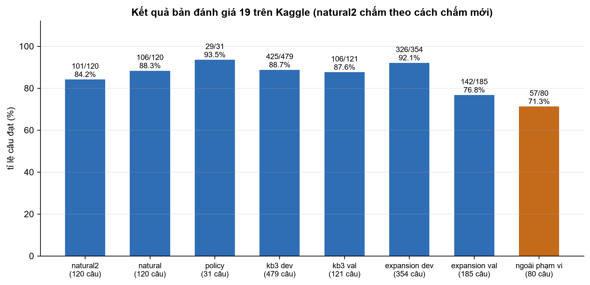

*Bảng 3.8. Kết quả bản đánh giá 19 (natural2 chấm theo cách chấm mới)*

| Bộ | Đạt / tổng | Tỉ lệ |
|---|---|---|
| natural2 | 101 / 120 | 84,2% |
| natural | 106 / 120 | 88,3% |
| policy | 29 / 31 | 93,5% |
| kb3 development | 425 / 479 | 88,7% |
| kb3 validation | 106 / 121 | 87,6% |
| expansion development | 326 / 354 | 92,1% |
| expansion validation | 142 / 185 | 76,8% |
| Ngoài phạm vi (80 câu ngoài lề) | 57 / 80 | 71,3% |
| Đối chứng của bộ ngoài phạm vi | 14 / 20 | 70,0% |

Nhận xét:

- **Bản 19 qua cổng:** so với bản 18, mọi bộ ra đúng số câu đạt như cũ, không câu nào từ đạt thành trượt. Hai lượt chạy cho kết quả giống nhau.
- **natural2 tăng từ 98 lên 101** chỉ nhờ sửa cách chấm: ba câu bot trả lời đúng nhưng trích câu khác với đáp án mẫu. Cách chấm mới cho phép một câu có vài câu bằng chứng tương đương (`any_of`). Để so sánh công bằng, bản 19 được chấm lại bằng cách chấm mới trước khi dùng làm mốc cho bản 20.
- **Expansion validation thấp hơn development** (76,8% so với 92,1%). Điều này đúng như mong đợi khi nhóm chỉ sửa theo phần development: phần validation đo khả năng **tổng quát** chứ không đo việc "học thuộc". Khoảng cách này cho thấy còn lỗi chưa được phát hiện ở phần development.
- **Bộ ngoài phạm vi yếu nhất**, đây là lần chạy đầu, trước khi sửa. Các nhóm yếu: bài tập và giải toán (2/9), viết code (2/8), hỏi về cửa hàng khác (3/7). Kiểu sai hay gặp:
  - Bot trả lời "chưa có nguồn", hoặc lôi tài liệu không liên quan ra (hỏi code Python thì trích bài về CPU), thay vì nói rõ là ngoài phạm vi.
  - Bị chửi kiểu "bot ngu" thì bot hỏi lại "máy nào".

### 3.10.3. Phân tích lỗi và cải tiến

Nhóm phân loại mỗi câu trượt theo nguyên nhân trước khi sửa:

*Bảng 3.9. Loại lỗi và cách sửa*

| Loại lỗi | Ví dụ | Cách sửa |
|---|---|---|
| Định tuyến sai | Đặt hàng qua chat bị coi là "cần công cụ ngoài" | Thêm luật `route_guard` (bản 20) |
| Tìm sai tài liệu | Mã biến thể "B12M-081SG" bị lấn bởi dòng catalog "B12M" | Cho tài liệu riêng của mã biến thể cạnh tranh ngang với catalog |
| Thiếu từ khóa chính sách | "giao trong bao lâu", "trả lại hàng" không được nhận là câu chính sách | Bổ sung từ khóa |
| Chấm oan | Bot trích câu đúng nhưng khác đáp án mẫu | Cho phép đáp án thay thế (`any_of`) |
| Ngoài phạm vi chưa nói rõ | Bài tập, code, câu chửi | Đang làm cho bản 21 |

Phiên bản 20 (sửa định tuyến và cách chấm mới) đang được chạy trên Kaggle tại thời điểm viết báo cáo.

## 3.11. Hạn chế và hướng phát triển

**Hạn chế:**

1. **Dữ liệu kinh doanh là mô phỏng.** Kết quả cho thấy hệ thống làm đúng trên dữ liệu có cấu trúc giống thật, nhưng chưa được thử với dữ liệu và câu hỏi của khách thật.
2. **Chính sách cửa hàng là bản soạn tạm**, cần thay bằng chính sách thật.
3. **Ảnh sản phẩm chưa có quyền dùng thương mại.**
4. **Tốc độ phụ thuộc phần cứng:** trên GPU T4 mỗi câu mất 3–4 giây, nhưng trên máy cá nhân thiếu RAM có câu mất tới 20–120 giây.
5. **Bộ ngoài phạm vi** mới đạt 71,3%, cần cải thiện.
6. **Bộ xếp lại (cross-encoder)** đã huấn luyện nhưng chưa bật, vì chưa qua hết các bộ đánh giá.

**Hướng phát triển:**

1. Thu thập câu hỏi thật của khách (đã ẩn danh) để đánh giá và huấn luyện.
2. Sửa nhóm câu ngoài phạm vi theo phần development, đo lại bằng phần validation.
3. Tách lỗi còn lại thành "lỗi do mô hình" và "lỗi do code". Chỉ khi lỗi do mô hình chiếm phần đáng kể mới huấn luyện bản v6.
4. Bật bộ xếp lại khi qua đủ cổng.
5. Triển khai dịch vụ AI lên GPU trên cloud để web dùng ổn định.
6. Khai thác thêm kho dữ liệu cho admin: dự báo nhu cầu, phân khúc khách hàng (RFM), luật kết hợp giữa các sản phẩm hay mua cùng nhau.

## Tiểu kết Chương 3

Chương 3 đã trình bày cách áp dụng lý thuyết vào chatbot TechStore:

- Dữ liệu được ghi nguồn đầy đủ và tổ chức thành một kho dữ liệu nhỏ theo lược đồ chòm sao, nạp qua quy trình ETL có kiểm tra.
- Câu hỏi đi qua luật chắc chắn trước, rồi qua bộ định tuyến Qwen3 4B tinh chỉnh LoRA. Tài liệu được tìm bằng truy xuất lai TF-IDF + BM25 + vector nhúng, trộn bằng RRF. Số liệu admin được tính bằng SQL.
- Hệ thống được đo trên hơn 1.500 câu hỏi, tách development/validation, có cổng chống đi lùi. Bản 19 đạt 84–94% ở các bộ chính; bộ ngoài phạm vi còn yếu và đang được cải thiện.

# KẾT LUẬN

**Kết quả đạt được:**

1. Về lý thuyết, báo cáo đã trình bày:
   - Kho dữ liệu: định nghĩa, kiến trúc, mô hình nhiều chiều, OLAP, hai trường phái Inmon và Kimball.
   - Khai phá dữ liệu: khái niệm, phân loại, quy trình KDD và CRISP-DM, tiền xử lý, lĩnh vực ứng dụng và hướng nghiên cứu.
   - Các thuật toán của nhánh khai phá văn bản, truy xuất thông tin và phân lớp: TF-IDF, BM25, vector nhúng, RRF, kNN, Naive Bayes, hồi quy logistic, SVM, cây quyết định, transformer và LoRA. Có ví dụ tính tay cho TF-IDF, BM25, cosine, RRF và các độ đo đánh giá.
2. Về ứng dụng, đề tài đã:
   - Xây dựng được chatbot TechStore có dẫn nguồn, phân quyền khách và admin, trả lời số liệu bằng SQL.
   - Tổ chức dữ liệu thành kho dữ liệu nhỏ có ghi nguồn đầy đủ.
   - Đo chất lượng bằng các bộ câu hỏi tách riêng, có quy trình chống đi lùi.

**Bài học rút ra:**

- **Dữ liệu và cách đo quan trọng không kém thuật toán.** Nhiều lần điểm tăng không phải nhờ đổi mô hình mà nhờ sửa dữ liệu, sửa luật định tuyến, hoặc sửa cách chấm.
- **Kết hợp nhiều phương pháp tốt hơn dựa vào một phương pháp:** luật cho ca chắc chắn, mô hình cho ca đa dạng, SQL cho con số, truy xuất lai cho tìm kiếm.
- **Không tin điểm trên dữ liệu đã nhìn.** Khoảng cách giữa development và validation nhắc nhở rằng phải giữ một phần dữ liệu không đụng tới.

**Hướng phát triển:** cải thiện nhóm câu ngoài phạm vi, thu câu hỏi thật của khách, triển khai lên GPU cloud, và khai thác kho dữ liệu cho các bài toán dự báo, phân khúc khách hàng, luật kết hợp.

# TÀI LIỆU THAM KHẢO

[1] J. Han, M. Kamber, J. Pei, *Data Mining: Concepts and Techniques*, 3rd ed., Morgan Kaufmann, 2011.

[2] U. Fayyad, G. Piatetsky-Shapiro, P. Smyth, "From Data Mining to Knowledge Discovery in Databases," *AI Magazine*, vol. 17, no. 3, pp. 37–54, 1996. doi:10.1609/aimag.v17i3.1230. [https://ojs.aaai.org/index.php/aimagazine/article/view/1230](https://ojs.aaai.org/index.php/aimagazine/article/view/1230)

[3] W. H. Inmon, *Building the Data Warehouse*, 4th ed., Wiley, 2005.

[4] R. Kimball, M. Ross, *The Data Warehouse Toolkit: The Definitive Guide to Dimensional Modeling*, 3rd ed., Wiley, 2013.

[5] R. Agrawal, R. Srikant, "Fast Algorithms for Mining Association Rules," *Proc. 20th VLDB*, pp. 487–499, 1994.

[6] X. Wu, V. Kumar, J. R. Quinlan, et al., "Top 10 algorithms in data mining," *Knowledge and Information Systems*, vol. 14, no. 1, pp. 1–37, 2008. doi:10.1007/s10115-007-0114-2.

[7] P. Chapman, J. Clinton, R. Kerber, et al., *CRISP-DM 1.0: Step-by-step data mining guide*, SPSS, 2000.

[8] P. Lewis, E. Perez, A. Piktus, et al., "Retrieval-Augmented Generation for Knowledge-Intensive NLP Tasks," *NeurIPS*, 2020. [https://arxiv.org/abs/2005.11401](https://arxiv.org/abs/2005.11401)

[9] Y. Gao, Y. Xiong, X. Gao, et al., "Retrieval-Augmented Generation for Large Language Models: A Survey," 2023. [https://arxiv.org/abs/2312.10997](https://arxiv.org/abs/2312.10997)

[10] D. Q. Nguyen, A. T. Nguyen, "PhoBERT: Pre-trained language models for Vietnamese," *Findings of EMNLP*, 2020. [https://arxiv.org/abs/2003.00744](https://arxiv.org/abs/2003.00744)

[11] C. D. Manning, P. Raghavan, H. Schütze, *Introduction to Information Retrieval*, Cambridge University Press, 2008. [https://nlp.stanford.edu/IR-book/](https://nlp.stanford.edu/IR-book/)

[12] G. Salton, C. Buckley, "Term-weighting approaches in automatic text retrieval," *Information Processing & Management*, vol. 24, no. 5, pp. 513–523, 1988.

[13] S. Robertson, H. Zaragoza, "The Probabilistic Relevance Framework: BM25 and Beyond," *Foundations and Trends in Information Retrieval*, vol. 3, no. 4, pp. 333–389, 2009.

[14] G. V. Cormack, C. L. A. Clarke, S. Büttcher, "Reciprocal Rank Fusion Outperforms Condorcet and Individual Rank Learning Methods," *Proc. SIGIR*, pp. 758–759, 2009. doi:10.1145/1571941.1572114. [https://plg.uwaterloo.ca/~gvcormac/cormacksigir09-rrf.pdf](https://plg.uwaterloo.ca/~gvcormac/cormacksigir09-rrf.pdf)

[15] N. Reimers, I. Gurevych, "Sentence-BERT: Sentence Embeddings using Siamese BERT-Networks," *EMNLP*, 2019. [https://arxiv.org/abs/1908.10084](https://arxiv.org/abs/1908.10084)

[16] J. Devlin, M.-W. Chang, K. Lee, K. Toutanova, "BERT: Pre-training of Deep Bidirectional Transformers for Language Understanding," *NAACL*, 2019. [https://arxiv.org/abs/1810.04805](https://arxiv.org/abs/1810.04805)

[17] V. Karpukhin, B. Oğuz, S. Min, et al., "Dense Passage Retrieval for Open-Domain Question Answering," *EMNLP*, 2020. [https://arxiv.org/abs/2004.04906](https://arxiv.org/abs/2004.04906)

[18] R. Nogueira, K. Cho, "Passage Re-ranking with BERT," 2019. [https://arxiv.org/abs/1901.04085](https://arxiv.org/abs/1901.04085)

[19] Y. A. Malkov, D. A. Yashunin, "Efficient and robust approximate nearest neighbor search using Hierarchical Navigable Small World graphs," *IEEE TPAMI*, 2018. [https://arxiv.org/abs/1603.09320](https://arxiv.org/abs/1603.09320)

[20] T. Cover, P. Hart, "Nearest neighbor pattern classification," *IEEE Transactions on Information Theory*, vol. 13, no. 1, pp. 21–27, 1967.

[21] C. Cortes, V. Vapnik, "Support-vector networks," *Machine Learning*, vol. 20, pp. 273–297, 1995.

[22] J. R. Quinlan, *C4.5: Programs for Machine Learning*, Morgan Kaufmann, 1993.

[23] L. Breiman, J. Friedman, R. Olshen, C. Stone, *Classification and Regression Trees*, Wadsworth, 1984.

[24] E. J. Hu, Y. Shen, P. Wallis, et al., "LoRA: Low-Rank Adaptation of Large Language Models," *ICLR*, 2022. [https://arxiv.org/abs/2106.09685](https://arxiv.org/abs/2106.09685)

[25] T. Dettmers, A. Pagnoni, A. Holtzman, L. Zettlemoyer, "QLoRA: Efficient Finetuning of Quantized LLMs," *NeurIPS*, 2023. [https://arxiv.org/abs/2305.14314](https://arxiv.org/abs/2305.14314)

[26] Qwen Team, "Qwen3 Technical Report," 2025. [https://arxiv.org/abs/2505.09388](https://arxiv.org/abs/2505.09388); mô hình: [https://huggingface.co/Qwen/Qwen3-4B-Instruct-2507](https://huggingface.co/Qwen/Qwen3-4B-Instruct-2507)

[27] A. Vaswani, N. Shazeer, N. Parmar, et al., "Attention Is All You Need," *NeurIPS*, 2017. [https://arxiv.org/abs/1706.03762](https://arxiv.org/abs/1706.03762)

[28] K. Järvelin, J. Kekäläinen, "Cumulated gain-based evaluation of IR techniques," *ACM TOIS*, vol. 20, no. 4, pp. 422–446, 2002.

[29] A. McCallum, K. Nigam, "A Comparison of Event Models for Naive Bayes Text Classification," *AAAI Workshop on Learning for Text Categorization*, 1998.

[30] J. H. Friedman, "Greedy function approximation: A gradient boosting machine," *Annals of Statistics*, vol. 29, no. 5, pp. 1189–1232, 2001.

[31] R. J. Hyndman, G. Athanasopoulos, *Forecasting: Principles and Practice*, 3rd ed., OTexts, 2021. [https://otexts.com/fpp3/](https://otexts.com/fpp3/)

[32] dangvantuan, "vietnamese-embedding," Hugging Face, giấy phép Apache 2.0, bản `4ab46e4`. [https://huggingface.co/dangvantuan/vietnamese-embedding](https://huggingface.co/dangvantuan/vietnamese-embedding)

[33] docyx, "pc-part-dataset," GitHub, giấy phép MIT, commit `c52a04c`. [https://github.com/docyx/pc-part-dataset](https://github.com/docyx/pc-part-dataset)

[34] msjahid, "Ryans Laptop Inventory and Specifications," Kaggle, giấy phép Apache 2.0. [https://www.kaggle.com/datasets/msjahid/ryans-laptop-inventory-and-specifications](https://www.kaggle.com/datasets/msjahid/ryans-laptop-inventory-and-specifications)

[35] Unsloth AI, "Unsloth: fast LLM fine-tuning." [https://github.com/unslothai/unsloth](https://github.com/unslothai/unsloth)

[36] Ollama. [https://github.com/ollama/ollama](https://github.com/ollama/ollama)

[37] F. Pedregosa, G. Varoquaux, A. Gramfort, et al., "Scikit-learn: Machine Learning in Python," *JMLR*, vol. 12, pp. 2825–2830, 2011.

# PHỤ LỤC

## Phụ lục A. Nguồn dữ liệu chi tiết

### A.1. Bộ dữ liệu tham khảo cho bộ mô phỏng

Các bộ này chỉ dùng để lấy phân phối thống kê, **không đưa vào chatbot** và không phân phối lại.

*Bảng A.1. Bộ dữ liệu tham khảo*

| Bộ dữ liệu | Nơi lấy | Giấy phép |
|---|---|---|
| [abdelrahmanemad594/laptop-prices](https://www.kaggle.com/datasets/abdelrahmanemad594/laptop-prices) | Kaggle | Apache 2.0 |
| [elvinrustam/ebay-laptops-and-netbooks-sales](https://www.kaggle.com/datasets/elvinrustam/ebay-laptops-and-netbooks-sales) | Kaggle | CC0 |
| [juanmerinobermejo/laptops-price-dataset](https://www.kaggle.com/datasets/juanmerinobermejo/laptops-price-dataset) | Kaggle | Apache 2.0 |
| [mkechinov/ecommerce-behavior-data-from-multi-category-store](https://www.kaggle.com/datasets/mkechinov/ecommerce-behavior-data-from-multi-category-store) | Kaggle | Bản quyền tác giả gốc |
| [mkechinov/ecommerce-events-history-in-electronics-store](https://www.kaggle.com/datasets/mkechinov/ecommerce-events-history-in-electronics-store) | Kaggle | Bản quyền tác giả gốc |
| [mkechinov/ecommerce-purchase-history-from-electronics-store](https://www.kaggle.com/datasets/mkechinov/ecommerce-purchase-history-from-electronics-store) | Kaggle | Bản quyền tác giả gốc |
| [msjahid/ryans-laptop-inventory-and-specifications](https://www.kaggle.com/datasets/msjahid/ryans-laptop-inventory-and-specifications) | Kaggle | Apache 2.0 |
| [muhammadshahrayar/transactional-retail-dataset-of-electronics-store](https://www.kaggle.com/datasets/muhammadshahrayar/transactional-retail-dataset-of-electronics-store) | Kaggle | CC0 |
| [muhammadshahrayar/transactional-retail-of-electronics-store](https://www.kaggle.com/datasets/muhammadshahrayar/transactional-retail-of-electronics-store) | Kaggle | Chưa xác minh |
| [olistbr/brazilian-ecommerce](https://www.kaggle.com/datasets/olistbr/brazilian-ecommerce) | Kaggle | CC BY-NC-SA 4.0 (không thương mại) |
| Online Retail II | UCI Machine Learning Repository | CC BY 4.0 |

### A.2. Nguồn của 43 bài kỹ thuật

- **Intel:**
  - [RAM cho chơi game](https://www.intel.com/content/www/us/en/gaming/resources/how-much-ram-gaming.html)
  - [CPU chơi game](https://www.intel.com/content/www/us/en/gaming/resources/gaming-cpu.html)
  - [CPU và GPU](https://www.intel.com/content/www/us/en/products/docs/processors/cpu-vs-gpu.html)
  - [Chọn laptop gaming](https://www.intel.com/content/www/us/en/gaming/resources/how-to-pick-the-best-gaming-laptop.html)
  - [Thunderbolt 4 và USB-C](https://www.intel.com/content/www/us/en/architecture-and-technology/thunderbolt/thunderbolt-4-vs-usb-c.html)
  - [Thunderbolt 5](https://www.intel.com/content/dam/www/central-libraries/us/en/documents/2023-09/thunderbolt-5-technology-brief.pdf)
  - [Băng tần Wi-Fi](https://www.intel.com/content/www/us/en/support/articles/000099711/wireless.html)
  - [Wi-Fi 7](https://www.intel.com/content/dam/www/central-libraries/us/en/documents/2022-07/wifi7-features-bandwidth-qam-infographic-nologo-1920-1080.pdf)
  - [GPU tích hợp và rời](https://www.intel.com/content/www/us/en/support/articles/000057824/graphics.html)
  - [Bộ nhớ đồ họa](https://www.intel.com/content/www/us/en/support/articles/000041253/graphics.html)
  - Tên thế hệ CPU: [000032203](https://www.intel.com/content/www/us/en/support/articles/000032203/processors/intel-core-processors.html), [000100149](https://www.intel.com/content/www/us/en/support/articles/000100149/processors/intel-core-processors.html)
- **Kingston:**
  - [M.2 và SSD](https://www.kingston.com/en/blog/pc-performance/two-types-m2-vs-ssd)
  - [DDR5](https://media.kingston.com/kingston/articles/MKF_954-DDR5-Collateral_us.pdf)
  - [Hướng dẫn bộ nhớ flash](https://media.kingston.com/pdfs/MKF_283.2_Flash_Memory_Guide_VN.pdf)
  - [NV2](https://www.kingston.com/datasheets/SNV2S_en.pdf)
  - [KC3000](https://www.kingston.com/datasheets/KC3000_en.pdf)
- **Samsung:**
  - [OLED](https://www.samsung.com/us/tvs/tv-buying-guide/why-oled-tvs-are-worth-it/)
  - [Tần số quét](https://insights.samsung.com/2026/06/17/finding-the-right-refresh-rate-know-the-best-hz-for-your-needs/)
  - Over-provisioning SSD: [white paper](https://download.semiconductor.samsung.com/resources/white-paper/S190311-SAMSUNG-Memory-Over-Provisioning-White-paper.pdf), [845DC](https://download.semiconductor.samsung.com/resources/others/Samsung_SSD_845DC_04_Over-provisioning.pdf)
- **BenQ:**
  - [Tấm nền TN/VA/IPS](https://www.benq.com/en-us/knowledge-center/knowledge/how-to-choose-between-tn-va-and-ips-panels-for-the-games-you-play/.html)
  - [Độ trễ và thời gian phản hồi](https://www.benq.com/en-us/knowledge-center/knowledge/gaming-monitor-input-lag-versus-response-time-whats-the-difference-and-why-should-i-care.html)
  - [Màn hình chỉnh ảnh](https://www.benq.com/en-us/knowledge-center/knowledge/choosing-the-right-monitor-photo-editing.html)
- **Lenovo PSREF:**
  - [LOQ 15IRH8](https://psref.lenovo.com/syspool/Sys/PDF/LOQ/LOQ_15IRH8/LOQ_15IRH8_Spec.pdf)
  - [Legion Slim 5 16IRH8](https://psref.lenovo.com/syspool/Sys/PDF/Legion/Legion_Slim_5_16IRH8/Legion_Slim_5_16IRH8_Spec.pdf)
  - [ThinkBook 15 G2 ITL](https://psref.lenovo.com/syspool/Sys/PDF/ThinkBook/ThinkBook_15_G2_ITL/ThinkBook_15_G2_ITL_Spec.pdf)
  - [IdeaPad 3 15ITL6](https://psref.lenovo.com/syspool/Sys/PDF/IdeaPad/IdeaPad_3_15ITL6/IdeaPad_3_15ITL6_Spec.pdf)
- **MSI:**
  - [Modern 15 B12M-408AU](https://storage-asset.msi.com/specSheet/au/bnp/Modern%2015%20B12M-408AU.pdf)
  - [Modern 15 B12M-081SG](https://storage-asset.msi.com/specSheet/sg/bnp/Modern%2015%20B12M-081SG.pdf)
- **Các hãng khác:**
  - [Apple MacBook Air M1](https://support.apple.com/en-us/111883)
  - [Logitech G305](https://www.logitechg.com/en-us/products/gaming-mice/g305-lightspeed-wireless-gaming-mouse.910-005280.html)
  - [AMD Ryzen 9000](https://www.amd.com/en/partner/articles/ryzen-9000-series-processors.html)
  - [NVIDIA VRAM dòng RTX 40](https://www.nvidia.com/en-in/geforce/news/rtx-40-series-vram-video-memory-explained/)
  - [Adobe Photoshop: yêu cầu cấu hình](https://helpx.adobe.com/photoshop/desktop/get-started/technical-requirements-installation/adobe-photoshop-on-desktop-technical-requirements.html)
  - [USB-IF USB PD](https://www.usb.org/usb-charger-pd)
  - [NVM Express](https://nvmexpress.org/)
  - [Crucial DDR5](https://stage.crucial.com/articles/about-memory/everything-about-ddr5-ram)
  - 80 PLUS (CLEAResult): [chương trình](https://www.clearesult.com/80plus/program-details), [hỏi đáp](https://www.clearesult.com/insights/answering-your-80-PLUS-questions)

Link Crucial trỏ vào `stage.crucial.com`, là trang thử nghiệm của Crucial; sẽ đổi sang `www.crucial.com` khi cập nhật tài liệu.

### A.3. Ảnh sản phẩm

- 37 ảnh: nguồn ghi trong `AI/data/product_images/manifest.json`, lấy từ trang của hãng (Asus, Lenovo, MSI, Acer) và nhà bán lẻ ở nhiều nước, gồm cả Việt Nam.
- 30 ảnh bổ sung ngày 3/11/2026: lấy từ trang hãng (MSI, Samsung, LG) và nhà bán lẻ (Ryans, LDLC, CellphoneS, Memoryzone, Nguyễn Công PC, Quốc Đạt…).
- Ảnh dự phòng trên web lấy từ Unsplash, theo [Unsplash License](https://unsplash.com/license).
- Trường `rights_status` của mọi ảnh sản phẩm là "chưa xác minh quyền"; `commercial_reuse_approved = false`.

## Phụ lục B. Một số câu SQL mẫu trên kho dữ liệu

**Lãi gộp và biên lãi gộp theo tháng:**

```sql
SELECT month, net_revenue, gross_profit,
       ROUND(100.0 * gross_profit / net_revenue, 1) AS bien_lai_gop_pct
FROM monthly_pnl ORDER BY month;
```

**Ba sản phẩm doanh thu cao nhất:**

```sql
SELECT p.name, SUM(l.revenue) AS doanh_thu
FROM financial_ledger l JOIN products p ON p.sku = l.sku
GROUP BY p.sku ORDER BY doanh_thu DESC LIMIT 3;
```

**Số đơn theo kênh bán (slice theo chiều kênh):**

```sql
SELECT channel, COUNT(*) AS so_don FROM orders GROUP BY channel;
-- store: 768 | website: 460 | social: 199
```

**Tồn kho cuối kỳ:**

```sql
SELECT sku, quantity, value FROM inventory_daily WHERE day = '2026-09-30';
```
